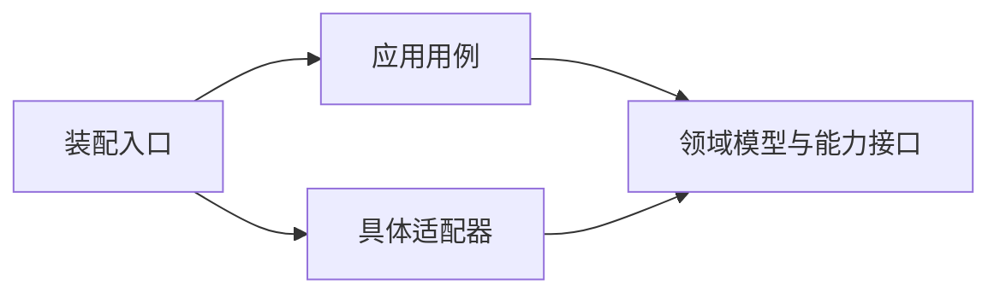

# 领域边界与依赖

读取触发：新增能力、拆分模块、改变依赖、公开接口或状态归属。

## 确定领域边界

领域围绕一个稳定职责组织其概念、状态、行为和不变量。例如，未来的执行环境能力需要保证文件操作与命令执行属于同一环境，并由该能力拥有环境注册与目标路由。

划分时回答四个问题：

1. 该能力解决什么问题，哪些规则由它决定？
2. 哪些状态由它拥有，谁可以修改？
3. 对外提供什么契约，依赖其他能力的哪些契约？
4. 哪些变化通常一起发生，哪些实现可以独立替换？

完成标准是能够描述职责、状态所有者、公开接口、依赖方向与验收范围。文件数量、技术框架或目录名称本身不构成领域边界。

具体领域随能力确定，当前框架代码不按文件机械划为多个领域，也不预先创建空的领域模块。

## 领域内部组织

| 角色 | 负责什么 | 允许依赖 |
| --- | --- | --- |
| 领域模型与规则 | 领域概念、不变量、状态转换 | 领域值与必要的稳定契约 |
| 应用用例 | 调用顺序、操作编排、事务或生命周期边界 | 领域模型及能力接口 |
| 能力接口 | 定义需要的外部操作及错误语义 | 领域输入输出类型 |
| 适配器 | 具体进程、文件系统、网络或存储实现 | 所实现的能力接口 |
| 装配入口 | 选择实现、配置依赖与资源 | 应用用例与具体适配器 |

这些是逻辑职责，不要求每个领域建立五个目录。简单能力可以只有接口、实现和测试；规则复杂后再增加内部结构。

箭头表示代码依赖。领域规则保持对 Pi、传输协议、Node / OS 和具体远端服务商独立；必要的外部操作由能力接口表达。

## 跨领域交互

- 每个领域声明公开入口，消费方只依赖公开类型与操作。TypeScript 可通过模块入口导出，Go 使用明确的导出接口与类型。
- 一个领域的状态通过其公开操作读取或改变。其他领域不直接访问它的私有状态、内部存储或具体适配器。
- 跨领域调用由应用用例编排，避免相互持有实现造成循环依赖。
- 领域事件仅在需要解耦独立行为时引入；普通同步调用可以继续使用公开接口。
- 共享代码限于实际跨领域的稳定机制。领域特有模型保留在所属领域；放入共享目录需要说明真实复用方。

跨语言共享的是通信契约，不要求 TypeScript 与 Go 镜像拆成相同目录。传输 DTO 与领域内部类型由边界转换，避免协议格式驱动领域模型。

## DI 与生命周期

TypeScript 的应用服务使用 Effect 声明能力依赖，Layer 构造具体实现，Scope 管理资源。领域纯计算保持为普通函数；Pi 的 Promise 与 AbortSignal 在接入边界转换。

Go 保留普通构造函数，Wire 在启动入口选择并组装实现。运行时的环境选择由领域的注册与路由机制处理，不由 Wire 的静态依赖图决定。

为资源确定所有者、共享范围和释放时机。请求取消只结束该请求；共享连接在其所有者关闭时释放。跨语言取消需要等待实际执行终态或明确报告无法确认。

## 接口与验证

新增接口必须明确输入输出、错误、取消、超时、并发、资源所有权及副作用。写入和命令执行的重试策略由操作语义决定。

| 变化 | 验证依据 |
| --- | --- |
| 领域规则或状态转换 | 不变量、合法与非法状态、失败后的状态 |
| 应用用例 | 操作顺序、依赖错误、取消与资源释放 |
| 适配器 | 实际目标行为，以及它实现的能力契约 |
| 跨语言接口 | 两端格式、错误、版本和生命周期一致性 |
| 公开入口或依赖 | 消费方使用公开接口，依赖图无环 |

问题排查先核对调用链、代码和测试，再通过日志、复现或测试验证候选原因，定位第一个错误状态。修改前说明根因、影响范围和修复计划，验证修改后的实际行为。

## 当前框架的兼容范围

当前 TS 正式模块位于 `src/modules/`，能力服务、Live Layer 与工具适配器各有职责；根目录旧入口保留兼容导出。模块契约与统一生命周期见 [TS 模块说明](typescript-modules.md)。Go Runner 依赖 Directory，远端 Server 依赖 Target，具体实例由启动入口装配。实现与验证入口见 [模块依赖与装配](module-dependencies.md)。

Go Runner 仍集中处理诊断与 stdio 通信；适配器内部可以依赖自己的执行内核或协议转换。这不授权跨领域消费方依赖具体适配器。后续新增独立领域能力时，声明契约与依赖规则，沿用公开入口和测试验证兼容性。

每个正式领域形成后，在最靠近代码的位置建立局部说明，并将职责摘要、公开入口、源码与测试入口加入 [上下文索引](../context/index.md)。具体领域目录不在本规范中固定。
