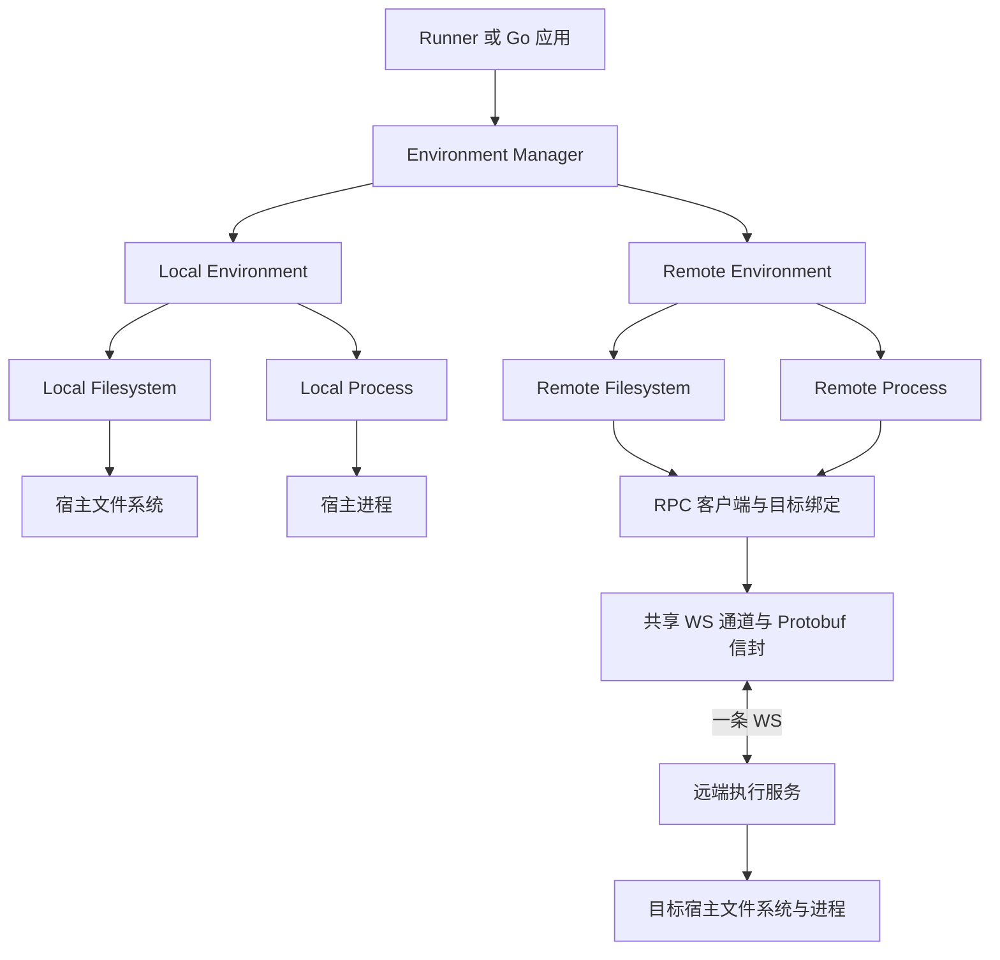

# 环境管理与能力接口

状态：Environment、Filesystem、Process 与 Manager 已进入 [Go SDK](../../go/environment/environment.go)，Local 和 WS Remote 均已实现。使用与平台验证范围见 [执行指南](../development/execution.md)。

读取触发：设计或实现环境管理、本地与远端环境、文件系统、进程能力及其资源生命周期。远端文件消息与失败语义见 [文件 RPC 草案](../../protocol/filesystem-rpc.md)。

## 已确认的边界

| 组成 | 职责 |
| --- | --- |
| Environment Manager | 注册、发现、查找环境，管理环境生命周期 |
| Environment | 返回属于该目标的 Filesystem 和 Process |
| Filesystem | 提供基本读写、目录列表、文件信息与创建目录 |
| Process | 使用 Exec 执行一次性 Bash，回调传输出并返回终态；详见 [接口方案](process.md) |
| Local Environment | 返回访问宿主文件系统与进程的实现 |
| Remote Environment | 返回通过 RPC 访问目标的实现 |

Environment 不平铺文件操作或命令执行方法。调用方先按 ID 获取环境，再使用它提供的能力对象。接口关系示意如下；Process 类型见 [接口方案](process.md)，Filesystem 签名以公开 Go 契约为准，此片段展示已实现的接口边界：

```go
type Environment interface {
    Filesystem() Filesystem
    Process() Process
}
```

管理器依赖 Environment 接口，Local 和 Remote 分别实现它。Runner 通过 Directory 的 Get / IDs 消费管理器，不依赖具体 Manager。能力对象已经绑定目标，文件与进程方法无需再次传入 environmentId。当前构造与验证边界见 [模块依赖与装配](module-dependencies.md)。

## 目标架构



LocalProcess / LocalFilesystem 直接访问它们所在进程的宿主。Remote 场景需要本机调用进程与远端执行进程；远端执行器接收 RPC 后复用这两项 Local 能力，再按需启动 Bash 子进程。远端文件和进程访问必须落到同一个已配置目标及文件视图。详见 [本地执行方案](local-execution.md) 与 [远端双进程方案](remote-executor.md)。

## 环境管理

- environmentId 是本地管理器中的实例标识；同一种实现可以注册多个实例。
- 宿主创建并注册环境，连接配置保留在 Go 侧；第一版 Remote 不做身份权限。Agent 查询只获得公开描述。
- 未知 ID 和重复 ID 明确失败；操作失败不改变目标，不回退其他环境。
- 第一阶段采用启动时注册、运行期间保持绑定稳定的方案。动态移除与替换需要另行定义活动请求处理规则。
- 管理器关闭时停止接收新操作，处理活动操作后释放它拥有的环境资源。已注册环境的资源所有权在 Go API 定稿时明确。

Wire 负责构造管理器及环境集合；运行时按 ID 查找由管理器完成。SDK 使用方可以直接调用普通构造函数。

## 本地 Filesystem

Local Filesystem 是宿主文件操作的适配实现，直接使用 Go 标准库访问真实文件。默认工作目录只用于解释相对路径；绝对路径使用宿主原生语义。

Go 的本地文件实现负责参数校验、读取上限、资源释放和错误归一。文件写入与宿主程序、Local Process 访问的是同一份数据。

## 远端 Filesystem

远端第一版选择共享 WebSocket 通道上的 RPC 访问文件，不要求本机挂载点或文件系统驱动。Remote Filesystem 是进程内的能力对象，文件数据保存在远端目标，而非另建一份本机内存文件系统。

Remote Environment 持有已在 SDK 初始化期间建连的 Client 引用和远端目标引用，向 Filesystem 与 Process 提供一致的目标绑定。一次文件操作结束释放该操作的资源。环境关闭处理它拥有的执行并释放客户端引用；多个环境共享的连接由共同所有者管理，环境关闭不停止远端执行器服务。资源关系见 [远端方案](remote-executor.md)。

本地 environmentId 和远端 targetId 属于不同的注册边界。Remote Environment 的宿主配置把二者绑定起来，文件调用自动附带 targetId；模型不能在文件参数中提交任意地址或切换远端目标；本版 Remote 不引入认证凭据。

请求的路径属于远端目标。客户端不使用自身操作系统的 filepath 规则解析它；相对路径与符号链接由目标文件实现处理。

## Filesystem 接口草案

当前范围已收敛为基本文件操作，复杂操作交给同一环境的 Process 转发 Bash 命令。主接口不再要求兼容 io/fs.FS，也不引入完整文件句柄模型；本地仍直接使用宿主文件系统，远端采用按路径操作的 RPC。

下面描述基本能力；当前 Go 签名见公开契约，资源默认值见 Remote v1。

| 方法 | 领域输入 | 领域结果与语义 |
| --- | --- | --- |
| ReadFile | 路径、可选字节偏移与长度、请求上下文 | 返回字节；省略长度表示读到 EOF，但受 SDK 读取上限约束；超过上限返回明确错误，不静默截断 |
| WriteFile | 路径、字节、请求上下文 | 创建或覆盖文件；不自动创建父目录；普通覆盖写入不承诺原子替换或回滚 |
| ReadDir | 路径、请求上下文 | 条目名称与类型，按名称排序；目录结果上限和排序规则在协议中统一 |
| Stat | 路径、是否跟随符号链接、请求上下文 | 类型、大小、修改时间；草案默认查看链接本身，沿用原型行为 |
| Mkdir | 路径、是否递归、请求上下文 | 创建目录；递归模式允许已有目录，已有文件返回类型错误 |

Filesystem 的领域类型与 RPC DTO 独立，远端适配器负责转换。文本解码、按行预览属于上层；字节偏移不等同于文本字符或行号。

一次 ReadFile 可以由多个远端分段读取请求组成，但不承诺整个文件快照。并发修改下的快照或一致性版本校验需要独立能力。

## Agent 使用与复杂操作

Agent 通过简单工具调用读文件、写文件、列目录、查询信息及创建目录。各操作显式选择 environmentId，目标工作目录、连接、字节编码与资源释放由工具和 SDK 处理。

复制、移动、删除、搜索、批量修改与压缩等复杂操作通过 Process 执行 Bash 命令，不增加对应的 Filesystem 方法。远端命令经 RPC 在远端目标执行；本地命令在本地目标执行。

文件与 Bash 操作必须选择同一环境，并保持工作目录与文件视图一致。执行失败不切换目标；Bash 操作产生的文件变更可通过该环境的 Filesystem 读取。

Agent 工具已在 [Pi 入口](../../src/pi.ts) 注册；参数与运行示例见执行指南。

## 平台支持

三个平台均有实现路径；macOS 已实际运行集成测试，Windows 与 Linux 已交叉编译，仍需各自实机验证。

| 维度 | 处理规则 |
| --- | --- |
| SDK 宿主平台 | 本地 Filesystem 采用宿主原生文件接口，远端 Filesystem 使用 RPC 客户端 |
| 远端目标平台 | 由远端服务解释目标路径、文件类型与权限错误 |
| 跨平台访问 | 例如 Windows SDK 访问 Linux 目标，远端路径仍采用 Linux 目标语义 |

基础文件能力按三个平台的宿主实现适配。实际执行 Bash 的目标须提供可用的 Bash，环境描述应明确该能力；本机仅作 Remote RPC 调用方时无需 Bash。Windows 执行侧的 Bash 配置、路径与取消需要单独验证。未配置 Bash 时明确报告对应能力不可用，基础文件能力仍可使用；SDK 不静默改用其他 Shell。

当前原型的命令执行只面向 POSIX，Go Windows 已实现原生暂停启动与 Job 管理，目前只完成交叉编译。

## 两条通信链路

1. TypeScript → 本机 Go Runner：已经存在的 stdio 框架 v1，负责 Pi 接入和本机请求管理。
2. Go Remote Environment → 远端服务：待实现的 RPC，负责访问目标文件系统与进程。

第二条链路以 [一条 WS 通道](../../protocol/remote-channel.md) 复用文件请求响应、Process 输出事件与控制消息，消息使用 Protobuf 编码；完整消息和默认值见 [v1 首版契约](../../protocol/remote/v1/README.md)，网络库、生成代码与运行实现已落地。取消单个请求不关闭共享 WS；SDK 初始化时建连，检测断线立即失败，不自动重连或补发命令 / 文件修改。远端协议独立版本化，Runner 在跨语言边界转换领域结果，不直接转发远端原始错误。

连接共享范围、与本机框架的兼容接入及实施验收见 [远端传输决策](remote-transport.md)。

## 替代方案与兼容

FUSE、macFUSE 和 WinFsp 的挂载方案已经讨论，本轮选择直接 RPC 作为基础能力。后续若需要普通本机程序通过目录访问远端，可增加可选挂载层并复用远端访问核心。

已有 SSH/SFTP 或云厂商 API 可以后续通过适配器接入统一能力接口。当前既不引入挂载依赖，也不承诺交付这些连接实现。

## 定稿前需要解决

- Go 公开类型、错误类型、配置上限、环境描述与关闭接口。
- 五项基本文件操作的 Go 签名、输入默认值与结果类型。
- 文件 RPC 首版消息和默认值已提供；后续落实目标绑定、版本与字节边界，不在第一版加入身份权限。
- Process 的 Exec 接口与行为已形成 [方案](process.md)；接下来将类型、资源管理和 [RPC 事件](../../protocol/process-rpc.md) 落到源码与验证。
- Windows 路径、文件与进程行为的实机验证范围。

设计验收包括同一环境文件与命令互通、多个环境同名路径独立、未知目标无副作用、字节分段边界、输出有界、写入失败结果、请求取消及共享连接释放。
