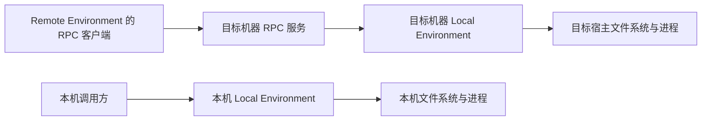
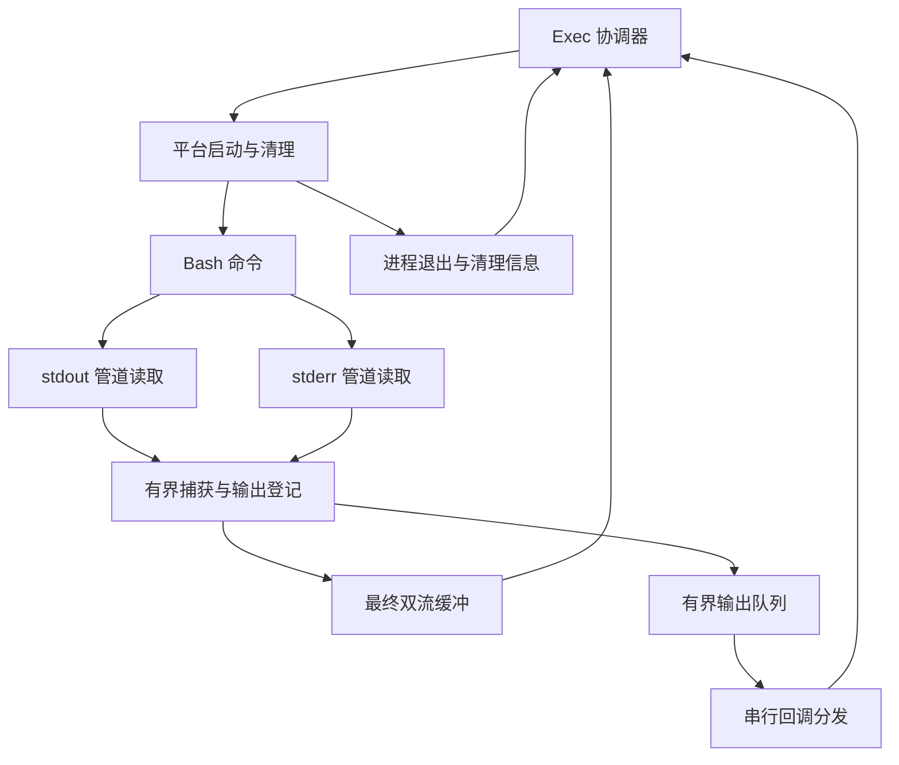

# 宿主文件与进程执行方案

状态：Go Filesystem / Process 首版已实现，本文保留底层设计依据。实际入口见 [Local](../../go/environment/local/environment.go) 与 [执行内核](../../go/internal/execution/engine.go)。macOS 本地与远端测试已运行，Windows / Linux 目前验证到交叉编译。

读取触发：实现 Local Environment、宿主文件操作、Bash 启动、输出收集、进程清理或平台适配。公开职责以 [环境接口](environments.md) 为准，命令输入输出与错误以 [Process 契约](process.md) 为准；本文补足实现路径，不新增公共方法或冻结包目录。

## 两种部署复用同一执行内核

Local Environment 提供 LocalFilesystem 和 LocalProcess，操作它所在宿主的真实文件与进程。远端执行服务收到 RPC 后，也使用目标机器上的这两项实现；网络发送、执行 ID 登记和终态查询归 [Process RPC 边界](../../protocol/process-rpc.md)。



本地直接调用不要求额外执行服务进程。远端服务进程承载执行内核，再创建 Bash 命令子进程。两种入口均不将文件复制到独立内存文件系统，也不创建 FUSE 挂载。

## 构造与资源归属

普通构造函数接收依赖，由 Wire 在启动处选择具体平台实现。静态装配与运行时环境查找分开，遵循 [领域装配规范](domain-boundaries.md)。正式构造入口为 local.New(local.Config)，具名实例由 Wire provider 根据定义集合创建。

| 依赖或资源 | 持有者与用途 |
| --- | --- |
| 默认工作目录 | Environment 持有稳定的目标原生绝对路径，Filesystem 与 Process 共用 |
| Bash 配置 | Environment 提供目标宿主上的已解析可执行文件；Agent 不提交 Shell 路径 |
| 基础环境变量 | 宿主在构造时提供副本；每次命令合并请求覆盖项 |
| 文件限制 | Filesystem 使用读取、写入和目录条目上限，默认值见协议与文件实现，Agent 与 Go SDK 分别限额 |
| 执行策略 | Process 使用运行预算、清理宽限、输出队列与转发限制，以及执行并发额度 |
| 平台启动与清理实现 | Process 依赖，负责受管理进程范围及原生句柄 |
| 单次文件句柄 | 该文件操作独占，在操作完成时关闭 |
| 单次执行资源 | 该 Exec 独占协调器、管道、捕获缓冲、事件队列和进程管理对象 |

配置在运行期间保持稳定，输入 map 和字节数据不能被调用方并发修改后影响已启动操作。每次 Exec 建立独立运行状态；多个执行共享配置及并发额度，不共享 Shell 会话、输出缓冲或取消对象。

环境关闭由所有者协调：停止接收新操作，取消并处理活动执行，再释放环境持有资源。取消单次操作不关闭其他操作依赖的环境资源。关闭 API 和注册环境的资源所有权仍由环境接口定稿决定。

## 目标路径与环境变量

Filesystem 的相对路径，以及 Exec.Cwd 的相对路径，均以环境默认工作目录为基准；空 Cwd 使用该目录。绝对路径按目标宿主规则解释。路径中含引号或 Shell 表达式时，文件接口仍将它作为字面文件名，不经过 Bash。

每次调用计算自己的目标路径，不调用进程级 os.Chdir、os.Setenv 或 os.Unsetenv。默认目录用于定位，不构成访问隔离或权限限制。符号链接遵循所调用宿主操作的语义；文件路径与命令内部访问必须落在同一文件视图。

Bash 脚本文本作为 bash -c 的一个参数传递，不自行拆词，也不把 Cwd 和 Env 拼进脚本。环境变量合并产生新的 key=value 列表；校验空键、键中的等号与键值中的 NUL。Windows 的环境变量键按平台规则处理大小写与重复项，不能依赖 Go map 的随机迭代顺序解决冲突。

配置的 Bash 路径在构造时解析；请求中的 PATH 覆盖只影响 Bash 启动后的命令查找。启动配置属于目标宿主，远端服务不会继承 RPC 调用方的本机目录或环境变量。PWD 与实际 Cwd 的一致性由目标执行配置处理并验证。

## Filesystem 直接使用宿主文件接口

能力范围保持五项基本操作，具体参数与结果见 [环境文件能力](environments.md#filesystem-接口草案) 和 [文件 RPC 契约](../../protocol/filesystem-rpc.md)。复制、移动、删除、搜索、压缩等通过同一环境的 Process 执行 Bash。

| 操作 | 本地实现路径 | 需要处理的边界 |
| --- | --- | --- |
| ReadFile | os.Open 后按字节偏移读取，结束时关闭句柄 | 偏移超出 EOF 返回空字节；在循环中检查取消；超出返回上限明确失败 |
| WriteFile | 校验完整请求后使用 os.WriteFile 或等价的 OpenFile / Write / Close | 创建或覆盖，不创建父目录；写入与关闭错误都保留；失败可能留下部分文件 |
| ReadDir | os.Open 后分批 File.ReadDir，汇总有界条目并按名称排序 | 检出超限则报错，不将部分目录伪装成完整结果；排序沿用 UTF-8 字节规则 |
| Stat | 默认 os.Lstat；要求跟随链接时使用 os.Stat | 元数据归一为已约定的类型、字节大小与修改时间 |
| Mkdir | 普通模式 os.Mkdir；递归模式 os.MkdirAll | 已有目录与已有文件按模式区分；权限由宿主配置与平台规则决定 |

即使省略读取范围，也不能无上限调用 os.ReadFile 后再截断；应使用有界读取，必要时多探测一个字节确认超限。Stat.Size 只用于提示，不能代替实际读取消费限制。多个读取块之间不承诺文件快照。

WriteFile 在打开或截断前检查上下文及输入大小；普通宿主系统调用不能保证执行中立即取消。操作已经成功时保留成功事实，失败时保留可能产生副作用的信息，不因随后观察到取消就声称未写入。成功也不承诺 fsync 持久化或原子替换；Go 的普通覆盖写入可能留下部分内容。[Go WriteFile 说明](https://pkg.go.dev/os@go1.25.5#WriteFile)

读取和写入原始字节，文本解码在 Pi 或调用方进行。错误适配保留 os.PathError 等底层原因，同时转换为业务错误。Windows ACL、POSIX mode 和特殊文件的完整控制不扩展到当前公共元数据；不能把宿主特有字段默认为跨平台一致。

## Process 的内部职责



协调器唯一拥有运行状态、停止原因和最终提交权；读取任务、回调分发器、等待任务只汇报事件。一次 Exec 只调用一次等待/回收，只提交一次终态。

### 内部执行范围与通知

公开 Process.Exec 保持现有契约，不增加启动回调、OS PID 或执行句柄。LocalProcess 与远端执行器可以共享内部执行内核及执行范围：平台成功创建并纳入管理后发送内部启动通知，完成清理后发送内部终态通知。远端执行器据此生成 started 和状态查询结果，不能用首条输出推测已经启动。

运行状态与一次公开调用的返回值分开持有。Exec 清理宽限耗尽后可以返回 unconfirmed，但执行侧 owner 仍持有尚未结束的进程句柄、管道、清理任务及状态；继续实施清理并接收实际结束通知，不把返回视为资源责任结束。未确认范围继续计入活动资源限制，避免连续调用留下无限无人管理的任务。

公开调用返回后不再触发 onOutput，也不异步改写已返回 ExecResult；后续管道可以由执行内核有界排空并丢弃，内部清理终态交给 owner。远端执行器在保留的执行状态中记录后续确认结果，本地环境关闭也需要处理这些范围。owner 本身退出或重启导致控制资源丢失时，不能声称此前未确认执行已停止。

### 启动与管道所有权

1. 校验参数、能力与限制，申请执行额度，形成独立运行上下文；启动前已取消则不创建 Bash。
2. 创建受管理进程范围和两条输出管道，关闭 stdin：POSIX 实现中 Cmd.Stdin=nil 对应空设备。
3. 平台启动器配置 Bash 参数、目标目录、环境变量、输出句柄和进程范围，启动失败时关闭已取得资源并释放额度。
4. 启动成功后，本机执行内核立即关闭它自己持有的 stdout/stderr 写端，只保留读端；子进程持有各自继承的写端。
5. 独立任务分别读取双流与等待主进程。主进程退出后协调器清理仍存活的受管理子进程，再等待输出 EOF 或触发有界读取收尾。

POSIX 启动可以建立在 exec.Cmd.Start / Wait 上，其 Start 最终调用 os.StartProcess。将自行创建的 *os.File 写端交给 Cmd 时，管道归 SDK 所有；不能指望 Cmd.Wait 或 WaitDelay 替 SDK 关闭这些读端。Go 的 StdoutPipe / StderrPipe 则由 Cmd 管理，Wait 会关闭它们，必须满足读取与等待的顺序约束。[Go Cmd I/O 与 Wait 说明](https://pkg.go.dev/os/exec@go1.25.5#Cmd)

本方案选择 SDK 自持管道，使“主进程已退出”与“输出已读完”可分别观测。父进程遗留写端会阻止 EOF，过早关闭读端则可能丢失尾部数据。所有启动失败、取消、读取错误与正常结束路径都需要覆盖这两类资源问题。

### 输出收集与慢消费者

两个读取任务使用固定大小缓冲；统一捕获器按观察顺序原子地计算 stdout/stderr 合计保留量，保留最早的 MaxOutputBytes。跨流顺序只是观察顺序，各流内顺序保持不变。

给回调的字节块使用独立存储，不暴露会被读取任务复用的缓冲。不能在捕获锁内调用用户函数或发送 RPC。回调串行执行；回调为 nil 时跳过分发，仅保留结果。

输出队列按字节和条目设置上限，转发总量与最终捕获量分开计数。达到队列或转发上限后，停止转发被限制的后续输出、设置 OutputTruncated，继续排空双流；不得阻塞管道读取或无限积累内存。回调已经排队的内容在终态前完成分发，返回后不再调用回调。

读取失败或被迫关闭读端时设置 OutputIncomplete。回调错误交给协调器，触发本次执行清理并按公开契约返回 OUTPUT_FAILED。回调不遵守上下文时，Go 无法强制终止该用户函数；契约要求回调及时返回，不能通过另开无限 goroutine 伪装成满足生命周期要求。

远端服务把同一输出分发路径接到 RPC 事件发送器，具体帧上限、事件序号与终态发送机会以 RPC 契约为准。命令输出不能直接写入 Runner 的协议 stdout。

## 超时、取消与确认结束

运行预算取请求 Timeout、环境默认预算和调用方截止时间中的适用较早值。清理使用独立、有界的上下文，运行截止后仍保留确认机会；初始宽限及可配置项沿用 Process 契约。

```text
准备 → 启动 → 运行 → 清理 → 提交终态
                 ↑        ↑
               输出事件   主进程退出 / 取消 / 超时 / 输出失败
```

正常主进程退出也进入清理，避免后台子进程持续运行或占用输出写端。退出与取消并发发生时，协调器串行登记已观察事实；已提交终态不再改变。仅观察到 ctx.Err 不能反推出停止原因，更不能覆盖已确认的正常结果。

| 事实 | 最终处理 |
| --- | --- |
| 尚未创建进程，输入、能力或启动失败 | not_started，保留实际错误，ExitCode 为空 |
| 主进程已回收，受管理范围已结束，输出完成 | finished，保留主进程退出码；非零退出码本身不是 Go 错误 |
| 取消/超时/输出失败，受管理范围确认已结束 | finished 加对应错误；保留可确认的退出信息和部分输出 |
| 主进程或受管理范围无法在清理宽限内确认结束 | unconfirmed / OUTCOME_UNKNOWN；保留可获得信息，不声称停止成功 |
| 受管理进程已结束，但输出读取失败或收尾中断 | finished 与 OutputIncomplete，同时保留对应 I/O 或控制错误 |

错误优先级保留触发停止的主因；若无法确认清理，OUTCOME_UNKNOWN 作为最终分类并携带触发原因。信号/终止返回值、主进程 Wait 成功和管道 EOF 分别只证明部分事实，不能互相替代。进程已终止也不回滚命令产生的文件副作用。

### Linux 与 macOS

启动前建立独立进程组，Bash 与没有主动脱离的子进程属于同一次执行范围；停止对该组实施。Go 的默认 CommandContext 仅 Kill 主进程，不能替代进程范围清理。[Go CommandContext](https://pkg.go.dev/os/exec@go1.25.5#CommandContext)

平台实现可以按配置选择停止信号，最终使用强制终止收尾；所有等待受清理预算约束。清理既处理主进程，也处理组内剩余任务；仅向进程组发送信号成功不能认定 finished。确认逻辑需要区分权限失败、仍存活与仅剩待回收状态，并避免在执行结束后持续操作失效或复用的进程标识。

进程组是第一版兼容边界，不能保证控制主动 setsid / 改变进程组的程序。更强的 Linux 进程容器或隔离机制可以作为后续平台策略，不改变公共 Process 契约；macOS 不能被描述成具有相同的 Linux 隔离能力。

### Windows

Windows 使用已配置的原生 Bash 运行环境。平台启动器以 Job Object 管理本次执行；普通子进程默认归属同一 Job，策略不主动允许脱离。TerminateJobObject 用于结束 Job 内进程，KILL_ON_JOB_CLOSE 可以作为资源释放保护。[Job Objects](https://learn.microsoft.com/en-us/windows/win32/procthread/job-objects)、[终止 Job](https://learn.microsoft.com/en-us/windows/win32/api/jobapi2/nf-jobapi2-terminatejobobject)

需要在 Bash 开始运行前完成归属，避免启动后再 AssignProcessToJobObject 的竞态。可实现的原生路径是创建暂停的 Bash、绑定 Job、恢复主线程；绑定失败则保持停止并回收全部句柄，不让命令提前执行。[CREATE_SUSPENDED](https://learn.microsoft.com/en-us/windows/win32/procthread/process-creation-flags)、[绑定 Job](https://learn.microsoft.com/en-us/windows/win32/api/jobapi2/nf-jobapi2-assignprocesstojobobject)

Go 1.25.5 的 syscall.StartProcess 在返回前关闭新进程主线程句柄，因此只在 exec.Cmd 上设置 CREATE_SUSPENDED 不足以完成上述启动路径。Windows 平台启动器应掌握原生 process/thread/Job 句柄，或验证其他能在开始执行前完成 Job 绑定的机制；这属于内部启动策略，不新增公共接口。[Go Windows 启动源码](https://github.com/golang/go/blob/go1.25.5/src/syscall/exec_windows.go)

确认结束需要回收主进程并检查 Job 的活动进程状态，不能把 Job 句柄普通等待或单次通知当作所有任务均退出的证明。ActiveProcesses 可通过 Job 查询获得，最终组合查询、进程等待和输出收尾；已有父 Job、嵌套 Job 和 Bash 的子进程归属必须实机验证。[Job 活动进程统计](https://learn.microsoft.com/en-us/windows/win32/api/winnt/ns-winnt-jobobject_basic_accounting_information)

Windows 原生路径与 Bash 的路径转换应验证空格、Unicode、盘符和符号链接。WSL 中的 Bash 属于另一个目标执行视图，不能仅把 wsl.exe 当作 Windows 原生 Bash 配置，就默认它与宿主 os 文件操作语义一致；需要明确目标绑定与路径映射后单独接入。本文不承诺已经完成 Windows / WSL 验证。

## 根本方案与兼容边界

完整实现使用跨平台共享的执行协调器、双流捕获和分发机制，平台启动器负责原生启动、进程范围及确认停止。LocalFilesystem 直接接宿主；远端执行服务复用相同目标能力，业务内核不依赖 Pi、stdio 或 WS 传输。

兼容落地可以先在 POSIX 目标上使用 exec.Cmd 与独立进程组验证内核，但需要明确这是进程组管理，不能宣称 Windows 或任意脱离子进程已经支持。Windows 走独立平台启动路径；未配置 Bash 时返回能力不可用，基本文件操作仍可使用。

现有 Runner 的 stdio 保持框架入口，业务输出事件、等待预算和 DTO 在 [通信接入方案](../../protocol/process-rpc.md#stdio-接入) 中扩展。原型的 Shell 默认值、文本输出、错误码与取消实现只是参考，正式契约保持 Bash、原始字节和明确终态；不能机械搬运原型。

## 证据、验证与平台边界

| 已核对证据 | 结论 | 对实现路径的影响 |
| --- | --- | --- |
| [本地文件原型](../../prototypes/typescript/src/local/environment.ts) | 原型直连宿主，路径以默认目录解释；明确拒绝 Windows，Shell 默认 /bin/sh | 复用行为目标，按 Go 契约重写并补平台适配 |
| [命令原型](../../prototypes/typescript/src/local/process.ts) | 双流分开收集，捕获有限；取消与主进程退出时终止进程组 | 补充并发协调、有界分发和结束确认，保持一次性执行 |
| [原型本地测试](../../prototypes/typescript/test/local.test.ts) | 本轮 macOS 测试通过，覆盖文件互通、多环境、双流、超时和组内子进程清理 | 作为行为参考；不能冒充正式 Go 执行或跨平台验证 |
| Go 1.25.5 的 os/exec、os 文件及平台启动源码 | 默认取消、管道所有权、普通写入和 Windows 线程句柄均有具体边界 | 使用独立协调器、自持输出管道和 Windows 原生启动路径 |
| 上述 Windows 官方资料 | Job 管理范围、暂停启动与活动进程查询提供对应机制 | 后续必须在真实 Windows 环境验证，不以编译通过替代运行证据 |

在仓库根目录复核原型证据；依赖已安装后可执行：

```sh
node --import tsx --test prototypes/typescript/test/local.test.ts
go version
```

正式 Go 的 [本地测试](../../go/environment/local/local_test.go)、[远端测试](../../go/remote/integration_test.go) 和跨语言测试已覆盖首版行为。验证矩阵包括：基本字节与范围读写、超限写入无修改、目录上限和排序、链接、含空格与 Unicode 路径、文件与 Process 互通；命令验证成功和非零退出、输出跨块、有界慢消费者、回调失败、启动前取消、启动/取消竞态、主进程结束后的组内清理、预算耗尽与资源释放。Linux/macOS/Windows 分别验证平台行为；Windows 补测 Job 绑定失败、父 Job、主线程恢复与原生 Bash 文件视图。

当前公开签名、平台执行内核与资源管理已落地；仍需 Linux / Windows 实机验收。原型证据只作为历史参考，不替代正式源码和测试。
