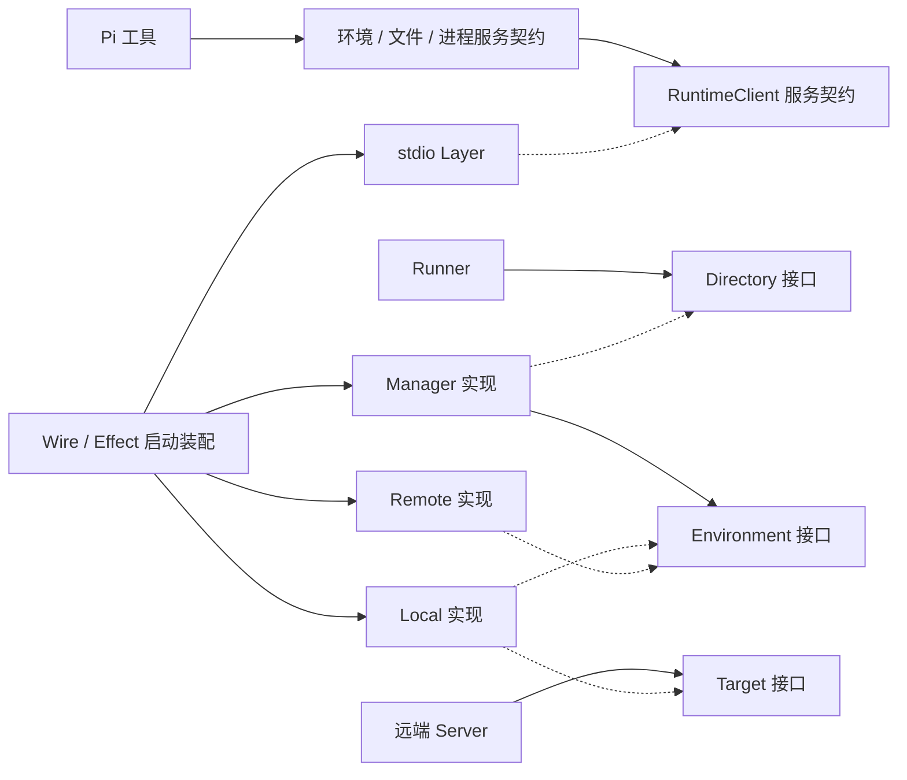

# 模块依赖与装配

状态：业务消费方通过能力接口接入实现。Go / TS 导入检查与接口替换测试已加入统一验证。读取触发：修改构造函数、公开接口、模块导入、Wire / Effect 或资源归属。

## 当前调用边界

| 消费方 | 依赖契约 | 当前实现 | 装配位置 |
| --- | --- | --- | --- |
| Go Runner | `environment.Directory`，只提供 Get / IDs | `environment.Manager` | Wire 启动入口 |
| 文件与命令调用 | `Environment`、`Filesystem`、`Process` | Local / Remote | Manager 注册与查找 |
| 远端 Server | `remote.Target`，包含环境能力、平台描述、执行通知与关闭 | Local 或独立后端 | Wire 或 Go 应用构造函数 |
| Pi 业务工具 | EnvironmentService / FilesystemService / ProcessService | 能力 Live Layer 或替换 Layer | `bootstrap/layers.ts` |
| TS 能力适配器 | RuntimeClientService | stdio 客户端或替换 Layer | 应用启动入口 |

接口、参数、结果与错误类型属于公开契约。业务消费方不构造具体适配器，不取出其内部执行对象。启动装配层选择实现，可以导入具体构造函数。



实线是代码依赖，虚线表示实现契约。运行时环境选择由 Manager 按 ID 完成，Wire 不参与每次请求的路由。

## Go 的构造与所有权

[Directory](../../go/environment/environment.go) 不暴露注册和 Close；Runner 只借用目录。Wire 将 Manager 绑定到 Directory，构造具名 Local 集合、兼容模式下的可选远端 binding、注册表与 Runner。`InitializeRunner` 返回 Server、cleanup 和 error；启动入口在 Serve 完成后调用 cleanup。初始化失败由 Wire 清理已构造的资源。

远端 binding 先关闭借用环境，再关闭自己拥有的 Client；具名 Local 集合由其 provider 清理；中途构造失败会关闭已创建的实例。直接使用 SDK 时也可以选择让 `Manager.Close` 统一关闭注册环境，Client 仍由连接所有者关闭。

[Target](../../go/remote/target.go) 是远端 Server 所需的后端契约，使用领域类型，不含 Protobuf 或执行内核类型。Local 通过 `RunProcess` 转发通知；Server 无需导入 Local。下面是应用装配示例，成功后调用方通过 `Server.Close(ctx)` 清理服务及目标：

```go
package example

import (
    "agent-kit/environment/local"
    "agent-kit/remote"
    "context"
)

func NewServer() (*remote.Server, error) {
    target, err := local.New(local.Config{Cwd: "."})
    if err != nil {
        return nil, err
    }
    server, err := remote.NewServer(map[string]remote.Target{"host": target})
    if err != nil {
        target.Close(context.Background())
    }
    return server, err
}
```

`RunProcess` 的 started 只在实际进程范围创建后发出；settled 表示实际清理完成。若返回 unconfirmed，后端继续拥有清理任务，settled 可以稍后触发，Server 在此之前保留执行额度。输出回调串行执行，返回后不再发出输出。目标平台由 Target 提供。

Local 内部使用 `internal/execution`，Remote 内部使用生成消息与 WS 实现。这些是适配器内部细节，不向业务消费方泄露；同一实现内部不要求每个对象都增加接口。

## TS 的完整边界与兼容方式

TS 已按 go-bridge、environment、filesystem、process、agent 五个模块落地。工具调用各自能力服务，Live Layer 借用 RuntimeClient。跨模块通过 index.ts 契约，工具装配入口可选择公开 tools.ts 适配器；bootstrap 组合实现。详细源码、统一启动与资源限制见 [TS 模块说明](typescript-modules.md)。

兼容入口保留 client.ts、runtime-client.ts、stdio-client.ts、protocol.ts、bootstrap.ts 和 pi.ts 的原导出；服务标识、工具名与 RPC 字段保持兼容。旧 createFrameworkTools 借用原有桥接运行时，现代应用构造一个完整服务图。

## 验证与扩展

`npm run check` 包含以下验证：

| 验证 | 保证什么 |
| --- | --- |
| [Go 导入规则](../../go/internal/architecture/dependencies_test.go) | 生产代码遵守声明的包依赖；Runner / Server 不能导入 Local 或执行内核；Wire 限于启动装配 |
| [TS 导入规则](../../test/architecture.test.ts) | 字面量 import / export / require 遵守入口规则；Pi 与契约不能导入 stdio；兼容导出保持标识一致 |
| [Runner 替换测试](../../go/internal/runner/business_test.go) | 独立 Directory / Filesystem 能接入，无需具体 Manager |
| [Server 替换测试](../../go/remote/target_test.go) | 独立 Target 通过真实 WS 提供文件与执行，正确处理元数据、通知与关闭 |
| [Effect 替换测试](../../test/bootstrap.test.ts)、[TS 模块测试](../../test/modules.test.ts) | 替换能力服务、共享单个桥接进程、创建失败及会话 / 连接释放 |
| [Wire provider 测试](../../go/internal/di/wire_test.go) | 初始化错误传递、清理后环境关闭与重复清理安全 |

导入检查不是完整语义分析；TS 不覆盖运行时拼接模块名。编译与替换测试共同验证构造边界。新增模块或改变依赖时，同步更新规则和说明，不能仅修改检查以放行未经设计的依赖。
