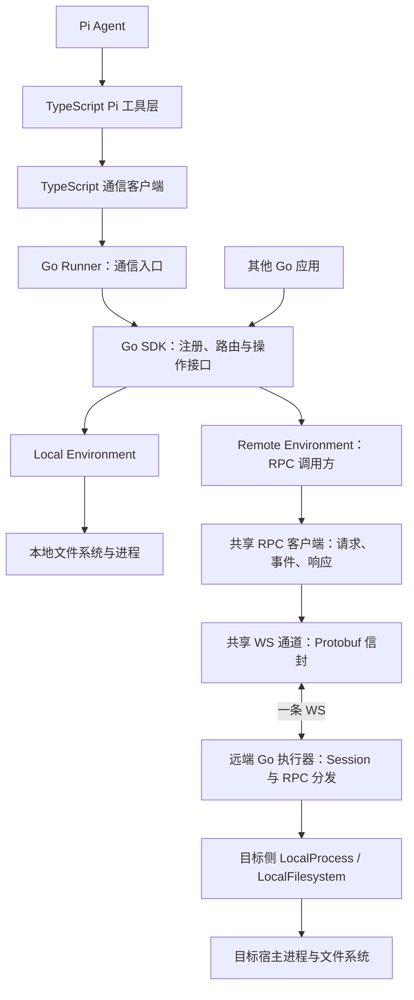
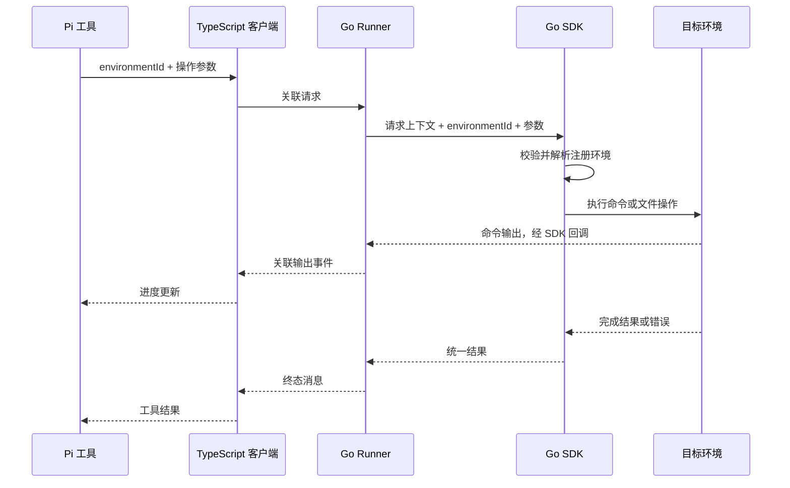

# Agent Kit 架构设计

更新日期：2026-10-12。

状态：首版执行代码已实现：Effect / Pi、Go Runner、Environment Manager、本地文件与 Bash、共享 WS 远端 Client / Server。使用和验证入口见 [执行指南](../development/execution.md)。macOS 已运行集成测试，Windows / Linux 已交叉编译；更完整的平台实测仍待完成。

当前初始化结构与启动方式见 [README](../../README.md)，已实现的通信格式见 [框架协议 v1](../../protocol/README.md)。下面关于业务能力、模块和远端适配器的内容描述目标方向，不代表已经交付。

当前工作顺序：先确定技术底座、运行框架与基础约束，再确定模块划分。此前讨论的包数量、模块和目录仅保留为参考，不作为实现约束。

后续能力按领域职责组织，具体模块在能力确定后划分。依赖、公开接口、DI 和渐进式上下文读取遵循 [架构规范入口](standards.md)；按任务查找相关文档使用 [上下文索引](../context/index.md)。这些规范通过仓库指令与评审执行，运行时上下文读取和领域级自动边界检查尚未实现。

环境管理、Environment 返回 Filesystem / Process、本地直连宿主及远端采用 RPC 的最新决策见 [环境管理与能力接口](environments.md)。远端最底层为 [一条共享 WS 通道](../../protocol/remote-channel.md)；文件契约见 [文件 RPC 草案](../../protocol/filesystem-rpc.md)，Process 的 Exec 定义见 [接口方案](process.md)，流式输出与控制见 [Process RPC](../../protocol/process-rpc.md)。这些业务能力已进入首版代码，本文保留架构决策与后续方向。

## 要解决的问题

Pi Agent 在执行命令、读取文件和写入文件时，需要逐次选择目标运行环境。目标可以是本机，也可以是远程服务器或云端沙箱。

项目提供两层能力：

1. TypeScript Pi 工具层：为命令和文件工具增加环境选择能力，将请求交给执行 SDK，并将输出、结果和错误返回 Pi。
2. Go 执行 SDK：提供统一的命令与文件系统接口，实现本地执行，允许后续接入不同远端运行环境。

例如，Agent 向 `sandbox-123` 写入源文件后，在同一环境执行测试，再从同一环境读取测试产物。每一步都明确传入 `environmentId`，可以在一次会话中访问多个环境。

## 已确认的决策

| 决策 | 内容 | 影响 |
| --- | --- | --- |
| 语言分工 | Pi 工具与调用客户端使用 TypeScript；执行 SDK 使用 Go | 文件与进程实现集中在 Go |
| TypeScript 依赖管理 | 使用 Effect 的服务依赖、Layer 装配与 Scope 资源管理 | TS 侧服务实现可替换，连接与请求生命周期显式管理 |
| SDK 独立性 | Go SDK 可以被 Go 应用直接调用 | Pi 与跨语言通信不进入 Go SDK 的核心依赖 |
| Go 依赖注入 | 使用 Google Wire，启动装配集中在应用入口 | SDK 和业务构造函数保持独立，编译前生成组装代码；具体目录未定 |
| 环境模型 | Environment 返回 Filesystem 与 Process 通用接口，Local / Remote 分别实现 | 能力对象绑定同一目标与工作区 |
| 文件能力范围 | 基本读写、目录列表、文件信息和创建目录；复杂操作由 Process 转发 Bash 命令 | Filesystem 不要求 io/fs.FS 兼容，文件与命令使用同一目标 |
| 环境选择 | 每次工具调用显式传入 `environmentId` | 会话可以访问多个已注册环境 |
| 环境配置 | 宿主配置并注册环境，Go 侧持有连接；Remote v1 暂不做身份权限 | 模型不负责提交任意连接配置 |
| 第一阶段通信 | TypeScript 启动本机 Go Runner 子进程，经 stdin / stdout 通信 | 本机不需要额外网络入口；访问远端仍需要目标执行器 |
| 远端通信 | 一条共享 WS 承载 RPC 文件请求、命令输出和控制消息，使用 Protobuf 编码 | SDK 初始化时建连、断线立即失败；v1 消息与默认值已给出，运行实现已提供，平台实测范围见执行指南 |
| 远端范围 | Filesystem 采用基本文件 RPC，Process 已形成一次性 Exec 方案 | 第一版不要求本机挂载，FUSE 等留作可选扩展 |
| 平台目标 | Windows、macOS、Linux | 区分 SDK 宿主平台与远端目标平台，需分别实现和验证 |
| 路由失败 | 未知环境报错，执行失败不回退其他环境 | 操作不会因错误被执行到不同目标 |

TypeScript 与 Go 在同一台机器通信，不限制 Go SDK 的目标环境：Go 侧仍然可以通过适配器访问远端。

Remote 模式有本机调用进程与独立远端执行进程。本机 RemoteProcess / RemoteFilesystem 调用 RPC，远端执行器接收后复用其宿主的 LocalProcess / LocalFilesystem；Bash 是执行侧的命令子进程。见 [本地执行](local-execution.md) 与 [远端执行器](remote-executor.md)。

## 分层与依赖方向



| 组件 | 负责什么 | 依赖边界 |
| --- | --- | --- |
| Pi 工具层 | 参数 schema、环境发现、操作请求、Pi 结果与进度展示 | 通过调用客户端访问 Go |
| TypeScript 客户端 | 请求关联、通信编码、输出事件分发、取消、连接关闭处理 | 不实现本地或远端文件与命令操作 |
| Go Runner | 通信解码、调用 SDK、输出事件编码、请求生命周期管理 | 不实现 Pi 工具或模型策略 |
| Go SDK | 环境管理及 Environment、Filesystem、Process 的统一契约 | 领域契约不依赖 Pi、stdio 或具体 RPC 传输 |
| 环境适配器 | 执行命令和文件操作，处理目标环境路径与生命周期 | 不依赖 Pi 或 TypeScript |

Go Runner 是 SDK 的使用方和跨语言入口。SDK 本身是 Go 库，其他 Go 应用无需启动 Runner 即可直接使用它。

远端传输的选择、兼容接入与分阶段验收见 [传输架构决策](remote-transport.md)。一条 WS 的范围是一个远端 Client 所有者；多个环境可以借用同一 Client，Local 能力直接访问宿主。

## 使用 Effect 管理 TypeScript 依赖

TypeScript 侧采用 Effect。服务声明需要的能力，Layer 负责构造实现并组合依赖；连接、监听器和由 TS 启动的 Go 子进程等资源通过 Scope 关联获取与释放。[服务与依赖](https://effect.website/docs/v3/requirements-management/services)、[Layer](https://effect.website/docs/v3/requirements-management/layers)、[Scope](https://effect.website/docs/v3/resource-management/scope)

正式框架已经固定 Effect 4.0.3，使用 `Context.Service`、`Layer.effect`、`Effect.acquireRelease` 和 `ManagedRuntime` 装配客户端并管理 Go 子进程。上述 v3 资料保留为概念参考；当前 API 以 [Effect v4 文档](https://effect.website/docs/v4/onboarding) 及安装版本的公开声明为准。

框架约束：

- TS 侧通过服务依赖访问配置、通信与调用能力，通过 Layer 在应用启动边界装配；具体服务数量与模块归属后续确定。
- 生产实现与测试实现通过替换 Layer 注入，不在工具内部直接创建隐藏的通信客户端或使用可变全局容器。
- 同一应用生命周期内复用已装配的连接；每个请求单独管理等待、输出消费与取消。取消单个请求不关闭其他请求共享的连接。
- Pi 的 Promise / AbortSignal 接口与 Effect 的执行、错误和中断模型在边界转换。Effect 服务对象和内部错误结构不直接写入跨语言协议。
- TS 侧操作中断需要通过取消协议传到 Go 上下文及目标环境。Effect 中断本身不证明 Go 或远端命令已经停止。
- 请求错误不触发自动切换环境，也不因使用 Effect 而默认增加重试策略。

应用关闭时先取消或结束请求，再释放共享连接与所属子进程。具体执行入口、Scope 边界和关闭确认方式随生命周期协议一起细化。

Effect 管理 TS 侧依赖与资源；Google Wire 生成 Go 侧启动组装；环境选择仍由 Go SDK 的 `environmentId` 路由完成。两侧 DI 机制保持在各自语言边界内。

## 使用 Google Wire 组装 Go 依赖

Go 启动依赖统一由 Google Wire 组装，使用编译前代码生成。构造函数通过参数显式接收依赖，Wire 生成普通 Go 初始化代码，不引入运行时依赖容器。[Wire 官方说明](https://github.com/google/wire)

以下路径来自此前目录讨论，仅用于说明装配职责，当前不冻结模块或路径：

| 参考位置 | 职责 |
| --- | --- |
| `go/sdk/` | 公开接口与普通构造函数，不引用 Wire |
| `go/environments/` | 环境实现与普通构造函数，不引用 Wire |
| `go/internal/runner/` | Runner 业务实现与构造函数，不引用 Wire |
| `go/internal/di/providers.go` | 组合配置、环境实例、SDK 和 Runner 的普通 provider 函数 |
| `go/internal/di/wire.go` | 带 `wireinject` 构建标签的 provider sets 和 injector 定义 |
| `go/internal/di/wire_gen.go` | Wire 生成的实际初始化代码，后续纳入版本控制，不手工修改 |
| `go/cmd/runtime-runner/main.go` | 调用生成的初始化入口，启动 Runner 并在退出时清理资源 |

Wire 组装应用启动时的依赖图。请求到达之后的 `environmentId` 路由由 SDK 注册表处理；按配置创建多个环境实例由 provider 内部的环境工厂处理。Wire 不负责根据每个请求动态选择环境，也不自动为多个同接口环境生成注册表。

建议的装配顺序为：配置 → 环境工厂和实例集合 → SDK 注册表 → Runner。单一接口实现需要绑定时可使用 `wire.Bind`；多个环境应通过明确的实例集合或注册表 provider 注入，避免对同一接口重复绑定。

对需要关闭的资源，provider 返回 cleanup 函数；初始化失败由生成代码清理已构造的依赖。正常关闭时先停止请求与实际执行，再释放环境连接等依赖。构造错误和资源清理应由测试验证。[Wire 使用指南](https://github.com/google/wire/blob/main/docs/guide.md)

SDK 使用方仍然可以直接调用普通构造函数，也可以在自己的应用中用 Wire 装配。Wire 的选择不改变 SDK 接口、通信协议和环境路由语义。

实现时需固定 Wire 工具版本，并增加重新生成后无差异的检查。官方仓库已标记不再维护，该状态作为工具链维护约束记录；本项目按已确认选择使用 Google Wire。[项目状态](https://github.com/google/wire)

`go/internal/di/` 通过 Wire 0.7.0 生成 `wire_gen.go`。Go 1.25 module 使用 `tool` 声明固定 Wire 工具，统一检查验证重新生成后没有差异。当前 injector 分别构造 Local、可选 Remote binding、Manager 与 Runner，并将 Directory / Target 绑定到实现；资源初始化失败时由生成代码清理。入口与兼容范围见 [模块依赖与装配](module-dependencies.md)。

## 环境选择与注册

环境管理持有实现统一 Environment 接口的实例。Environment 返回 Filesystem 与 Process 能力对象，操作方法定义在能力接口中；公开描述与生命周期签名待 Go API 定稿。具体边界见 [环境设计](environments.md)。

| 描述信息 | 用途 |
| --- | --- |
| `id` | 稳定的路由标识，例如 `local-dev` 或 `sandbox-123` |
| `kind` | 环境类型，例如本地或某种远端适配器 |
| `cwd` | 该环境解释相对路径的默认工作目录 |
| `description` | 帮助 Agent 选择环境的说明 |

宿主配置在 Go 侧构造具体环境实例并注册。环境查询返回适合提供给 Agent 的描述信息，不返回连接凭据。

约束：

- 工具层选择已注册环境。这里的“任意环境”指任何满足契约并已注册的实现，不是由模型直接创建任意远端连接。
- 命令和文件操作都从同一注册表解析 `environmentId`。
- 未知 ID 返回 `UNKNOWN_ENVIRONMENT`；重复 ID 拒绝注册。
- 相对路径交给所选环境按 `cwd` 解释；绝对路径属于所选环境。TypeScript 和 Runner 不按自身宿主路径重新解析远端路径。
- 环境注册不等于创建或回收沙箱，第一阶段不包含沙箱资源管理。

## Go SDK 的能力契约

下表明确能力语义，具体 Go 方法签名和类型组织待实现前细化。

| 能力 | 输入与输出语义 |
| --- | --- |
| 环境注册与发现 | 注册环境实例，列出公开描述信息 |
| 命令执行 | 输入命令、目标工作目录、环境变量、超时、输出上限；输出退出状态、stdout / stderr、截断信息和耗时 |
| 文件读取 | 按路径读取字节，支持零起始字节偏移与读取长度 |
| 文件写入 | 按路径写入字节，覆盖已有内容；UTF-8 文本通过字节接口传递 |
| 列出目录 | 返回目录项名称与类型 |
| 文件信息 | 返回类型、大小和修改时间，并明确符号链接行为 |
| 创建目录 | 支持按需递归创建父目录 |
| 取消与截止时间 | Go API 使用 `context.Context`，适配器将取消落实到实际执行 |

所有适配器使用相同的语义，但各自实现真实操作。例如，远端命令取消必须终止远端任务，仅取消客户端等待不足以满足契约。

Windows、macOS、Linux 已纳入支持目标。复杂文件操作经 Process 转发 Bash 命令，目标须具备 Bash；原型命令执行只面向 POSIX，Windows Bash 的配置、路径与取消仍需设计和验证。命令默认是一次性执行，调用之间不共享 `cd` 或 `export` 状态；工作目录与环境变量通过参数显式传递。

首版已沿用 60 秒运行预算与 1 MiB 输出捕获，其他预算及上限以 Remote v1 为准。

## Pi 工具层的调用方式

工具层提供环境查询、命令执行、文件读写、目录列表、文件信息与目录创建。除环境查询外，环境相关工具必须显式传入 `environmentId`。

以下是目标工具参数示例，不代表 Go Runner 已实现：

```json
{
  "environmentId": "sandbox-123",
  "command": "npm test",
  "cwd": "/workspace/project",
  "timeoutMs": 120000
}
```

TypeScript 将工具输入转换成请求，输出事件转换成 Pi 的进度更新，完成结果转换成工具结果。

Pi 工具可以展示 UTF-8 文本预览；SDK 保持字节能力。工具结果保留环境标识、命令退出码、输出截断状态等信息。非零退出码映射为 Pi 的失败工具结果，不能仅在文字中描述失败。

推荐使用明确的工具白名单，保证环境相关操作经过本项目的工具。原型中的 `runtime_*` 命名可以作为后续接口设计参考，正式工具名称见执行指南。

## 跨语言通信

| 方案 | 实现方式 | 定位 |
| --- | --- | --- |
| 第一阶段子进程方案 | TypeScript 启动 Go Runner，stdin 发送请求，stdout 接收结果与事件 | 本地兼容方案，便于打包与验证 |
| 后续独立服务方案 | Go Runner 作为独立服务，通过 HTTP 和事件流通信 | 支持独立部署和多个调用方 |

业务请求与结果的语义独立于传输方式。未来切换传输层不应修改 Pi 工具参数或环境适配器语义。

### 协议草案

框架基础通信已经采用 `version`、`id`、`method` 和 `params` 信封，具体方法和错误见 [框架协议 v1](../../protocol/README.md)。以下是后续命令、文件与输出事件的建议，业务协议尚未冻结：

- 每个请求沿用框架的 `id`、`method` 与 `params`；后续环境相关操作需明确携带 `environmentId`。
- 输出事件包含关联 ID、stdout / stderr 来源和输出片段。
- 完成结果包含关联 ID、执行结果或稳定错误码。
- 取消消息引用目标请求 ID，最终映射到 Go 的请求上下文。
- 已实现逐行 JSON、stdout / stderr 分离、协议版本和启动握手；后续被执行命令的 stdout / stderr 需要封装为输出事件。

以下对象用于解释请求关联，不是可直接调用的已实现接口：

```json
{
  "version": 1,
  "id": "request-001",
  "method": "command.exec",
  "params": {
    "environmentId": "sandbox-123",
    "command": "npm test",
    "cwd": "/workspace/project",
    "timeoutMs": 120000
  }
}
```

需要继续确定：消息类型与终态格式、版本兼容、并发与事件顺序、二进制传输、单消息上限、输出限流或背压，以及取消的确认方式。HTTP 路径、鉴权与事件流格式在服务阶段单独设计。

## 请求与取消流程



取消由 Pi 的取消信号进入客户端，客户端发送针对目标请求的取消消息。Runner 取消对应 Go 上下文，适配器停止实际执行并报告终态。

超时应由 Go 执行侧落实，客户端可额外限制等待时间。客户端等待超时或连接中断，不证明命令已经结束；后续协议需要明确如何报告未知执行状态，不能自动重试写入或命令。

Runner 关闭或通信断开时，应结束其所管理的请求并清理对应执行资源，具体关闭流程和进程管理方式待实现时确定。

## 错误与行为边界

推荐统一参数错误、未知环境、超时、取消、文件不存在、权限不足、执行器失败和连接失败的语义。具体错误码清单待协议细化。

- 非零退出码保留为命令结果，Pi 层将其标为失败；超时、取消和通信错误应能被区分。
- 操作失败不切换环境，命令和文件写入不自动重试。
- `cwd` 是路径基准，不能作为隔离保证。本地操作使用进程权限，真实隔离由目标运行环境提供。
- 第一阶段不提供持久 Shell、交互式 PTY、长期后台任务、文件事务或自动回滚。
- 本阶段 Filesystem 不提供删除、局部编辑、复制、移动、搜索或压缩等专用接口，相关操作由 Agent 通过同一环境的 Bash 命令完成。上传下载同步、多 Agent 调度或沙箱创建回收仍不在范围内。
- Remote v1 按当前用户决策先不做身份认证或目标 ACL；Session 仅用于连接资源归属，宿主自身权限错误仍保留。Server 部署配置继续待定。

## 历史目录讨论（未决策）

下面的布局来自此前讨论，仅保留为后续模块设计参考。当前先确定框架，不据此创建或固定包、模块和目录；Go module 路径尚未确定：

```text
agent-kit/
├── README.md
├── package.json                     # npm workspaces 与统一开发命令
├── package-lock.json
├── tsconfig.base.json
├── packages/
│   ├── pi-tools/                    # TypeScript Pi 工具
│   │   ├── package.json
│   │   ├── src/
│   │   │   ├── index.ts
│   │   │   ├── register.ts
│   │   │   └── tools/
│   │   │       ├── environments.ts
│   │   │       ├── exec.ts
│   │   │       └── filesystem.ts
│   │   └── test/
│   └── runtime-client/              # TypeScript 通信客户端
│       ├── package.json
│       ├── src/
│       │   ├── index.ts
│       │   ├── client.ts
│       │   ├── errors.ts
│       │   ├── protocol/
│       │   └── transports/
│       │       ├── transport.ts
│       │       └── stdio.ts
│       └── test/
├── go/
│   ├── go.mod
│   ├── go.sum
│   ├── sdk/                         # 独立 Go SDK，普通构造函数
│   │   ├── environment.go
│   │   ├── runtime.go
│   │   ├── command.go
│   │   ├── filesystem.go
│   │   ├── errors.go
│   │   └── runtime_test.go
│   ├── environments/
│   │   └── local/                   # 本地环境实现
│   │       ├── environment.go
│   │       ├── exec.go
│   │       ├── filesystem.go
│   │       └── environment_test.go
│   ├── internal/
│   │   ├── di/                      # Google Wire 启动装配
│   │   │   ├── providers.go
│   │   │   ├── wire.go              # wireinject 构建标签
│   │   │   └── wire_gen.go          # 自动生成，纳入版本控制
│   │   ├── protocol/                # Go 侧通信类型与校验
│   │   └── runner/
│   │       ├── server.go
│   │       ├── stdio.go
│   │       ├── requests.go
│   │       └── config.go
│   ├── cmd/
│   │   └── runtime-runner/
│   │       └── main.go
│   └── examples/
│       └── local-sdk/
│           └── main.go
├── protocol/                        # 跨语言消息的统一定义
│   ├── README.md
│   ├── schema/
│   └── examples/
├── examples/
│   └── pi-local.ts
├── test/
│   └── integration/
├── scripts/                         # 构建、协议与 Wire 生成检查
└── docs/
    ├── architecture/
    ├── guides/
    └── prototypes/
```

此前建议一个仓库、两个 TypeScript 包、一个 Go module；包数量和模块组织暂不确定。无论以后如何拆分，Go SDK 不导入 Runner、Pi 或 Wire 相关代码。远端适配器依赖 SDK 契约，具体归属在模块设计阶段确定。

根目录 `protocol/` 保存传输消息的统一定义，TypeScript 客户端和 Go Runner 的通信类型应由此生成或检查一致性。Go SDK 的领域类型独立于传输类型，由 Runner 做转换。

## 实施阶段

| 阶段 | 交付内容 | 验收依据 |
| --- | --- | --- |
| 1. 细化接口 | Go SDK 公开类型、请求与事件格式、错误与取消约定 | 能独立表达命令、文件和多环境操作 |
| 2. Go 本地 SDK | 环境注册、本地命令、本地文件系统、远端适配器契约 | 文件与命令互通，环境隔离，取消和超时测试 |
| 3. Go Runner 与客户端 | Effect 服务与 Layer、Wire 启动装配、子进程通信、请求关联、事件、取消、关闭处理 | 测试 Layer 可替换，生成一致性与资源清理通过，多请求无串流，终态不遗漏 |
| 4. Pi 接入 | 环境感知工具通过客户端调用 Go | Pi 会话完成文件写入、命令执行、结果读取 |
| 5. 远端执行器 | 本机 RPC 适配器与远端接收进程，复用目标侧 Local 能力 | 真实远端文件与命令一致，初始化建连、取消、断线立即失败与关闭验证 |
| 6. Runner 服务化 | 有额外部署需求时给调用方到 Runner 增加 HTTP 传输 | 业务语义一致，明确该入口的调用鉴权与授权 |

阶段表保留为实施参考。远端访问已确定为一条 WS 通道上的 RPC，正在细化消息与业务契约，交付顺序待定。第五阶段针对 Go SDK 到目标执行服务，第六阶段针对 TS / 其他调用方到 Runner 的服务化部署，两者不是同一条通信链路。

## 现有原型与目标实现的关系

| 当前路径 | 当前内容 | 后续如何使用 |
| --- | --- | --- |
| [原型工具层](../../prototypes/typescript/src/pi/tools.ts) | TypeScript 环境感知工具 | 参考参数与结果语义，改为调用正式客户端 |
| [原型注册与路由](../../prototypes/typescript/src/runtime.ts) | TypeScript 注册与路由 | 参考行为，将正式实现放入 Go SDK |
| [原型接口](../../prototypes/typescript/src/types.ts) | TypeScript 命令与文件接口 | 参考数据含义，细化 Go 类型与传输类型 |
| [原型本地执行器](../../prototypes/typescript/src/local/) | TypeScript 本地文件和命令实现 | 用 Go 实现正式本地适配器 |
| [原型测试](../../prototypes/typescript/test/) | 原型行为与 Pi 集成测试 | 参考未来 SDK 的业务场景 |

旧原型不参与正式 Go 框架入口，原型测试替身不能作为真实远端验证。原型运行方式见 [TypeScript 原型说明](../prototypes/typescript-prototype.md)。正式框架测试位于根目录 `test/` 和 `go/internal/`，覆盖真实 Go 进程与真实 Pi 工具循环，模型输出采用离线替身。

## 决策依据与后续验证

| 依据 | 得到的结论 | 对应设计或验证 |
| --- | --- | --- |
| 用户确认 TypeScript Pi 层与 Go SDK 分工 | 执行实现应归属 Go | 分层与依赖方向 |
| 用户指定 TypeScript 使用 Effect，并先确定框架 | TS 依赖管理使用 Effect；模块与目录继续保持未定 | Effect 装配、资源生命周期与边界转换约束 |
| 用户指定 Google Wire | Go 启动依赖使用 Wire 生成组装 | DI 规则、目标目录和生成一致性验证 |
| 用户选择先提供远端可插拔接口 | 第一阶段不绑定服务商 | Go SDK 契约与实施阶段 |
| Pi 提供自定义工具与事件接口 | 工具层可以传递环境选择与进度 | Pi 工具接入与离线工具循环测试 |
| 原型代码已使用 ID 路由文件和命令 | 可参考环境一致性与错误语义 | 多环境、未知 ID 和失败不回退测试 |

后续至少验证：本地实际文件与命令互通；多个环境同名路径独立；未知环境无副作用；输出有界；超时与取消终止目标任务；UTF-8 和二进制分段语义；通信关闭后的请求状态；Pi 工具实际经过 Go 执行。

Pi 能力依据来自此前已核对的 [SDK 文档](https://pi.dev/docs/latest/sdk)、[工具与扩展接口](https://github.com/earendil-works/pi/blob/main/packages/coding-agent/src/core/extensions/types.ts) 和 [命令工具源码](https://github.com/earendil-works/pi/blob/main/packages/coding-agent/src/core/tools/bash.ts)。这些链接用于说明集成边界；实现时还需以选定版本的公开接口核对具体签名。
