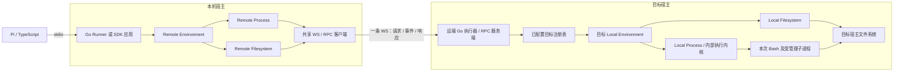
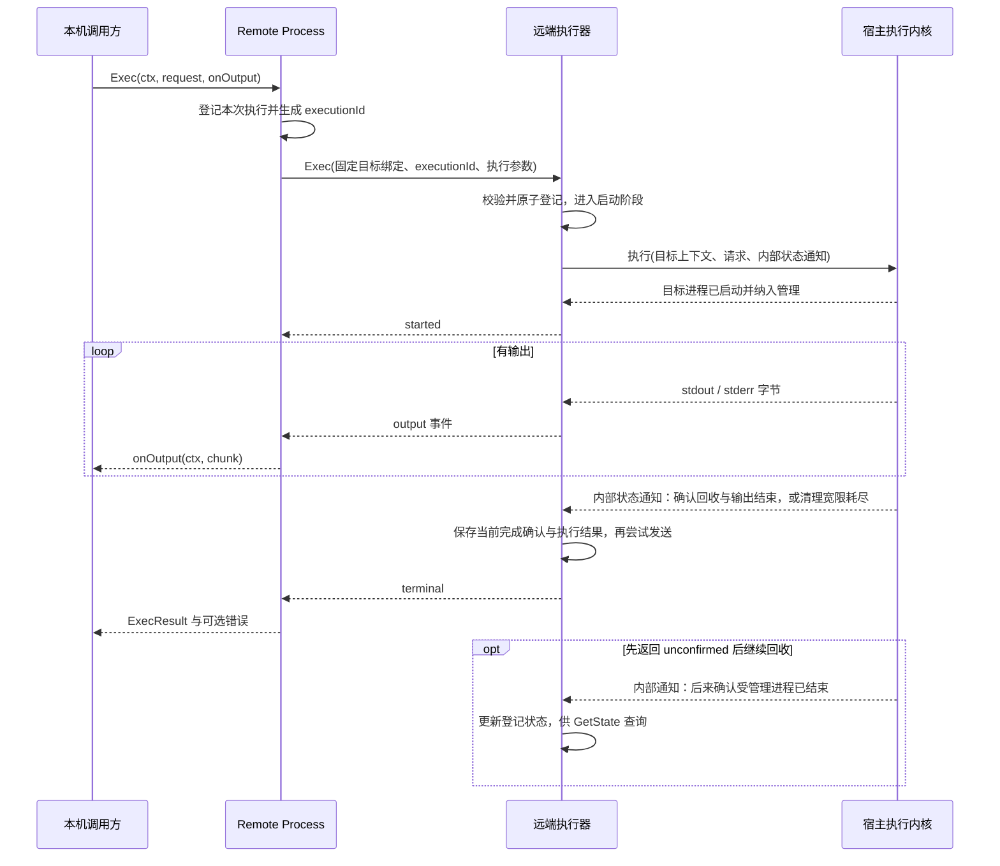

# 远端执行器与双进程架构

状态：Go Client / Server 与目标侧业务执行已实现，SDK 初始化期间建立共享 WS。消息与预算见 [v1 契约](../../protocol/remote/v1/README.md)，启动和验证见 [执行指南](../development/execution.md)。第一版不做身份权限或自动重连；CLI 提供基本启动参数，完整部署配置与 TLS 终止形式后续确定。

读取触发：实现 Remote Environment、远端执行器、连接所有权、部署入口或断线后的执行清理。公开能力见 [环境接口](environments.md) 与 [Process 接口](process.md)；底层连接与信封以 [WS 通道方案](../../protocol/remote-channel.md) 为准，执行状态与竞态以 [Process RPC](../../protocol/process-rpc.md) 为准，文件消息见 [Filesystem RPC](../../protocol/filesystem-rpc.md)。

## 分清本机调用进程与目标执行进程

Remote 场景包含 Client 侧 Go SDK 所在的调用进程和独立运行的远端 Go Server / 执行器。SDK 初始化时主动 Dial 远端地址，Go Server 监听并 Accept WS 连接，为每条连接创建 Session；两端在该连接上完成业务握手后才开放目标操作。建联、两端连接对象和状态归属以 [WS 通道方案](../../protocol/remote-channel.md#go-sdk-与-go-server-建联) 为准。远端接收方是 RPC 服务端，在自己的宿主上复用 Local Process 和 Local Filesystem；Bash 是它按命令启动的子进程。



直接使用 Go SDK 的应用可以替代本机 Runner；RPC 客户端作为应用内对象存在，不要求再启动第三个本机代理进程。本机仅调用 Remote Environment 时不需要 Bash、FUSE 或挂载盘。

## 组件与状态归属

| 组件 | 职责与拥有的状态 |
| --- | --- |
| 本机 Environment Manager | 持有已注册环境，按本地 environmentId 查找；所有权规则见环境方案 |
| Remote Environment | 持有固定目标绑定、RPC 客户端引用、自己发起的活动调用；返回两个能力对象 |
| Remote Process | 转换 Exec 参数、输出事件和最终结果；组织独立取消与状态确认 |
| Remote Filesystem | 转换基本文件请求、字节和错误；使用相同目标绑定 |
| RPC 客户端所有者 | 持有一条 WS、读循环、写调度器和请求关联；单次请求只拥有自己的逻辑流或等待资源 |
| 远端执行器 | 管理监听器、Session、目标集合、执行登记及有界近期状态；本版不做身份权限 |
| 执行记录 | 关联实际 Session、服务实例、targetId、executionId，持有取消器和清理状态 |
| 内部执行内核 / 执行范围 | 供 Local Process 与远端执行器复用，持有目标进程句柄、启动确认及持续回收责任 |
| 目标 Local Environment | 提供同一宿主及文件视图的 Local Process / Local Filesystem |

Process 领域接口保持一次性 Exec。Cancel、GetState、流事件和执行登记属于远端适配器与服务的传输机制，不向 Agent 增加这些控制方法。

## 绑定目标并确认能力

本机配置把 `environmentId` 映射到已初始化 Client 和 `targetId`；Client 使用远端 endpoint 建连，本版没有认证配置或用户 ACL。远端执行器把 `targetId` 映射到自己启动时配置的 Local Environment；路径、Bash、基础环境变量和默认工作目录由该目标提供。

例如本机 `remote-dev` 可以绑定服务上的 `project-a`。两端 ID 无需相同，Agent 只选择本机环境，不直接提交远端地址、凭据或 targetId。

连接准备先协商 WS 应用子协议并通过 system.hello 确认当前服务实例，再以 environment.getInfo 校验目标可用性、平台、默认工作目录、Bash 能力及服务端限制，并取得有限启动接纳租约。文件与命令共享一套目标描述；信封和协商以 WS 通道方案为准，完整消息源已有 v1 首版，SDK 在初始化期间完成这些校验，失败释放资源并返回错误。

同一 Remote Environment 的文件与命令始终附带同一绑定，服务端拒绝未知目标，不做调用者目标授权。第一版目标绑定在环境使用期间保持稳定，配置变化需要重新构造环境。连接失效的 Client 拒绝新调用，不自动重连；调用方可显式重新初始化处理新业务，不能把旧命令再次发送。

第一版服务直接在其所在宿主或容器内部注册目标。不同容器、虚拟机或沙箱应分别运行对应执行器；当前不增加容器跳转、沙箱自动创建或回收能力。默认工作目录是路径基准，不能宣称它本身构成隔离边界。

## 一次远端命令的链路



本机调用方、stdio 请求、远端执行和目标 OS 进程分别使用各自的关联信息。RPC 的 executionId 是远端控制句柄，OS PID 保留在执行器内部；完整登记与取消竞态见 [Process RPC](../../protocol/process-rpc.md)。

Local Process 的公开输出回调只描述输出，所以执行器通过与 Local Process 共享的内部执行内核接收启动与清理通知。内部执行范围持有目标进程句柄、取消器及回收状态，执行登记表据此产生 started、更新状态并回答 GetState。不能把“准备调用 Exec”或第一条输出误报成已启动，也不因此增加公共 Process 方法。

公开 Exec 清理宽限耗尽返回 unconfirmed 时，执行侧 owner 继续保留执行范围与清理责任，直到确认目标范围结束或服务退出。登记表仍把它视为待确认的活动执行，不能把一次方法返回等同于 finished；后续状态查询可以得到后来确认的终态，原输出流不再发送第二个 terminal。

文件操作采用普通请求响应。执行器校验目标后直接调用目标 Filesystem；当前文件方案没有执行结果记录和断线查询，不能把 Process 的状态保留保证套用于文件写入。

## 输出、取消与断线

执行器负责启动及清理目标 Bash；本机负责接收事件并转换成统一结果。输出读取、有限捕获与网络发送必须分开，慢客户端不能让远端日志管道停止排空。终态先保存到执行记录，再发送给客户端；发送失败不改写已确认结果。

调用取消时，Remote Process 用独立且有界的清理上下文在同一 WS 上调用 Cancel，并等待对应逻辑流终态或 GetState。它们是独立请求，不是独立物理连接；单个请求取消不关闭共享 WS。逻辑流取消或 WS Close 都不能证明目标进程已结束，执行器必须落实清理。

本机进程崩溃、网络中断或 WS 写入失败时，执行器在检测到连接失效后清理该连接会话所属的未结束命令，不按 targetId 取消其他会话的执行；网络故障可能不能立即被检测，因此目标运行预算仍由服务端计时并执行。SDK 检测断线即让原调用失败，不重连查询、不等待恢复、不重发原命令或文件修改；新的 Client / Session 不接管旧执行。禁止将断开的命令自动改为后台任务。清理无法确认、终态记录缺失或服务实例已经改变时，报告结果不确定。

## 分别关闭环境、连接与服务

| 关闭对象 | 行为 |
| --- | --- |
| 单次 Exec | 清理本次远端执行与本机流；保留共享客户端 |
| Remote Environment | 阻止新调用；取消并确认自己拥有的执行；处理活动文件调用；释放客户端引用 |
| 共享客户端 | 所有拥有者都释放引用后才关闭实际连接；外部注入的借用连接由外部所有者关闭 |
| 本机 Manager / Runner | 先关闭自己拥有的环境，再释放客户端资源，最后退出本机进程 |
| 远端执行器 | 由远端宿主的启动/停止机制管理；停止接收新业务、清理活动执行、释放目标资源及监听器 |

关闭 Remote Environment 不发送停止整个执行器的命令，也不关闭其他环境持有的连接。多个环境可以共享连接和服务；对执行的取消通过该环境记录的 executionId 发出，不能仅按 targetId 取消全部命令。

本机关闭宽限结束仍未确认目标停止时，应记录并向宿主报告 unconfirmed 后完成本机资源释放，不能改写成取消成功。远端执行器仍按自己的运行预算负责清理；不能把这个兜底当作已确认终态。

远端服务退出先进入业务 draining 状态，拒绝新的 Exec 和文件操作，在限定清理窗口内仍通过现有 WS 处理 Cancel / GetState；保存终态并尝试发送后进行 WS Close，最后关闭服务。不要过早关闭全部连接而阻断必要控制请求；目标进程回收仍是执行器责任，关闭握手不构成已停止的证据。

## Wire 装配与部署边界

两端使用普通构造函数，由各自启动入口的 Wire injector 装配：

Runner 依赖 Directory，Server 依赖 Target；Wire 将 Manager / Local 绑定到接口，业务消费方不导入具体适配器。Target 提供平台、默认目录、能力与执行通知，Local 的执行内核保持私有。构造与关闭规则见 [模块依赖与装配](module-dependencies.md)。

```text
本机：配置 → Local / 可选 Remote binding → Manager → Directory → Runner
远端：配置 → Local → Target 接口集合 → WS Server
```

远端执行器是独立部署的 Go 程序，远端宿主负责启动、停止和异常重启。本机连接已部署的服务，不默认负责上传二进制、启动远端进程或管理沙箱。当前已有 [Runner](../../go/cmd/runtime-runner/main.go)、[远端 Server](../../go/cmd/remote-server/main.go) 与两端 [Wire injector](../../go/internal/di/wire.go)。

v1 消息、租约、WS 库、生成代码、Wire 装配和默认预算已实现。Server CLI 已支持 listen、target、cwd、bash；完整部署配置文件和 TLS 终止形式尚未提供，本版不做身份权限。具名配置本轮只覆盖 Runner 的 local 实例。

完整方案增加独立远端入口并复用宿主能力、执行契约和普通构造函数。当前兼容落地保留 TS ↔ Go stdio Runner，在它后面接 Remote Environment，并按 [RPC 方案](../../protocol/process-rpc.md#stdio-接入) 扩展输出事件；不把远端服务塞进现有诊断 handler。

## 宿主与目标平台分别验证

| 场景 | 需要验证的边界 |
| --- | --- |
| Windows 本机调用 Linux / macOS 目标 | 本机只需要 RPC 调用能力；路径和 Bash 在目标解释 |
| Linux / macOS 本机调用 Windows 目标 | 文件采用 Windows 目标路径；Windows 目标必须配置 Bash 与一致的文件视图 |
| Windows 目标原生执行器 | Bash 路径映射、非 ASCII 路径、环境变量、双流输出与 Job / 受管理进程范围清理分别实测 |
| 在 WSL 内运行执行器 | 注册的是 WSL/Linux 目标，文件与进程都在 WSL 内处理；不能同时使用 Windows 宿主文件实现 |

Windows 目标可以使用 Job Object 管理关联进程，但它约束的是目标侧执行，不是本机 RPC 调用方。当前 Windows 原生 Job 执行实现已存在，但尚无 Windows 实机验收。[Windows Job Objects](https://learn.microsoft.com/en-us/windows/win32/procthread/job-objects)

## 验收入口

现有集成测试覆盖两个本机 Go 进程之间的文件写入与 Bash 读取、stdout/stderr 及非零退出、跨目标路由、执行前取消与启动竞态、流中断与目标清理、仍连通时的终态确认、断线立即失败且不自动重连、重启后的结果不确定，以及共享连接下关闭一个环境不会影响其他环境。

框架诊断测试继续保留；远端和命令行为由 [Go 两进程测试](../../go/remote/integration_test.go)、[跨语言远端测试](../../test/execution.test.ts) 与 [Pi 工具循环](../../test/pi.test.ts) 验证。平台覆盖范围见执行指南。
