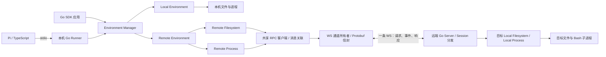

# 远端传输架构决策

状态：共享 WS / RPC 代码已实现，消息与预算沿用 [Remote v1](../../protocol/remote/v1/README.md)，使用与验证入口见 [执行指南](../development/execution.md)。本文记录职责、决策与验收方向。

读取触发：选择远端传输、划分通道与业务职责、安排实现顺序或核对兼容范围。连接和消息规则见 [WS 通道方案](../../protocol/remote-channel.md)，部署及资源所有权见 [远端执行器](remote-executor.md)。

## 确认的架构

Go SDK 中的 Remote Filesystem 和 Remote Process 共用 RPC 客户端。RPC 使用统一消息信封，经一条 WS 连接访问远端 Go Server；远端分发器调用目标侧 Local Filesystem 和 Local Process。

选择共享 WS，是因为文件操作需要请求响应、多个 Exec 需要连续输出，取消与状态查询还需要在执行期间独立发送。统一通道让这三类交互共用连接生命周期，业务层通过消息关联保留各自的调用边界。

一条连接的范围是一个远端 Client 所有者。同一 Client 上的多个环境通过 targetId 复用它；连接到不同地址或由不同所有者创建的 Client 分别持有连接。文件操作、命令执行、取消与状态查询不各自拨号。Local 能力直接调用宿主，不经过 WS。

WS 负责双向消息传输；RPC 层负责 request_id、方法分发、执行事件、终态和业务错误。这一职责划分是本项目的架构选择；WS 的消息、分片及控制帧规则以 [RFC 6455](https://www.rfc-editor.org/rfc/rfc6455) 为准。

## 职责与必须保持的边界

| 边界 | 约定 |
| --- | --- |
| 公共 SDK | Environment 仍返回 Filesystem / Process，Process 仍使用一次性 Exec；调用方不操作 WS 或 Session |
| 目标绑定 | Remote Environment 固定 targetId，文件与命令使用同一目录和文件视图 |
| 消息编码 | 一个完整 WS Binary Message 对应一个 Protobuf Envelope；字段唯一来源为 Remote v1 的四份 `.proto` |
| RPC 请求 | request_id 关联请求、事件和唯一响应；普通文件调用一次响应，Exec 输出事件后一次 terminal 响应 |
| 业务取消 | 用控制请求取消该调用；底层读写使用连接上下文，单请求取消不关闭共享连接 |
| 连接失效 | 检测到失效立即使该连接的活动调用失败，不自动重连、不补发写入或 Exec；执行器按实际 Session 清理 |
| 结果确认 | 已发送且无权威终态的执行报告 unconfirmed；文件修改报告结果未知，不把断线解释为未执行 |
| 资源所有权 | 环境释放自身请求和 Client 引用；最后一个拥有者释放物理连接；环境关闭不停止整个远端服务 |

读循环不能等待 Bash、文件系统调用或用户输出回调。写调度器采用有界队列，保持同一执行的消息顺序，在不同调用之间公平发送，并为控制和终态保留额度。单条 TCP 连接发生阻塞时，优先队列不能保证控制消息立即到达，具体策略见 [调度与背压](../../protocol/remote-channel.md#单通道调度与背压)。

## 完整方案与兼容接入

完整方案分为可独立验证的连接、RPC 与宿主执行职责。连接所有者管理 Dial / Accept、握手、心跳和共享连接关闭；RPC 处理请求等待、取消及事件分发；执行内核持有 OS 进程范围并落实清理。普通构造函数保持独立，由 Wire 在本机和远端各自的入口装配。

兼容接入保留现有 TS ↔ 本机 Go stdio 框架，在 Runner 后面接 Remote Environment。Runner 转换领域结果与 WS 事件，不向 Pi 直接暴露远端信封。stdio 两端已增加 process.output 事件、执行等待预算与事件能力声明；事件只更新输出，终态结束请求。

此前的 gRPC 服务端流建议被此决策替代。RPC 的请求关联、输出顺序、取消和终态语义继续保留，传输改为同一 WS 上的逻辑调用。HTTP / gRPC 不作为第一版并行实现；未来若增加传输适配器，需要维持公共能力契约。

## 实施顺序与验收

以下保留实施顺序与验收要求。当前前五阶段已有代码及集成验证；第六阶段的共享关闭、断线与清理已测试，Windows / Linux 的实机验证尚未完成。

| 阶段 | 实现内容 | 完成证据 |
| --- | --- | --- |
| 1. 消息与校验 | 明确 Go 生成映射，落实信封、方法表、必需字段与状态校验 | 四份消息编译通过；缺失与空值、未知方法、实例与序号校验通过 |
| 2. 通道与 RPC | 实现两端连接对象、初始化握手、Session、读循环、有界写调度和请求等待 | 同一 WS 并发请求能正确关联；单请求取消保留连接；握手失败释放资源 |
| 3. 宿主能力 | 落实已定的 Local 文件与执行内核，接入远端目标注册与分发 | 两个真实 Go 进程间写文件后通过 Bash 读取；字节、路径及非零退出行为一致 |
| 4. 输出与清理 | 接入真实 started、输出和唯一 terminal，落实取消、状态记录及持续回收 | 空输出命令、慢消费者、取消竞态、子进程清理及 unconfirmed 后回收通过 |
| 5. Pi 兼容接入 | 通过 Effect 管理本机 Runner，扩展 stdio 输出事件和文件 DTO | Pi 选择不同环境完成文件与命令操作；编码后消息满足现有 stdio 上限 |
| 6. 生命周期与平台 | 验证共享环境关闭、心跳、断线、服务退出和平台差异 | 一个环境关闭不影响其他环境；断线不补发；Windows / macOS / Linux 分别实测 |

前两阶段可用内存测试处理器验证通道，但不能当作文件与进程能力交付。具体预算、队列及消息上限以 v1 草案为唯一来源，不在此重复设置默认值。

## 当前范围与待定项

沿用仓库现有 v1 范围：初始化主动建连，第一版不做用户身份权限或会话恢复；Server 已提供 listen / target / cwd / bash 启动参数，完整部署配置与 TLS 终止形式尚待补充。网络库和生成器已在 Go module 固定，生成脚本随代码提供。沙箱创建、远端程序上传启动、FUSE 挂载、交互式 PTY、持久日志和断线续传不加入此传输决策。

当前代码包含本机 stdio、共享 WS Client / Server 与业务执行，协议入口见 [stdio](../../protocol/README.md)。验证依据是执行指南链接的真实两进程、stdio 与 Pi 测试；消息编译与平台交叉编译仍不能替代实机行为证据。
