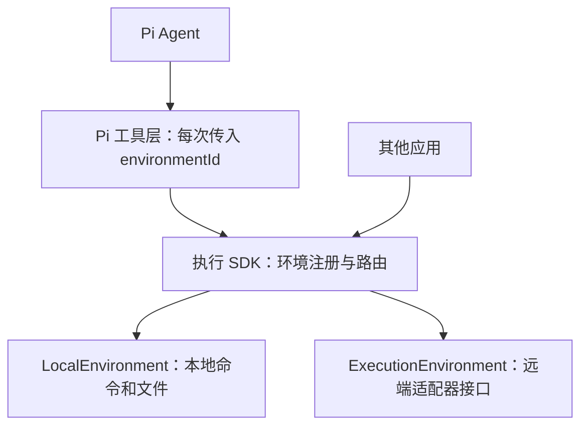

# TypeScript 原型使用说明

> 状态：历史原型，保留用于验证行为与参考测试。这里的 TypeScript 底层 SDK 不属于已确认的目标架构；正式底层 SDK 已由 Go 实现。正式框架已实现 Go Runner、本地 / WS 远端文件与命令 SDK、TS 领域服务和 Pi 统一启动；这里的旧原型不参与正式入口。
>
> 正式架构以 [架构设计](../architecture/overview.md) 为准。本文命令均从 `prototypes/typescript/` 目录执行，下面的 API 和示例只对应现有 TypeScript 原型。

为 Pi Agent 提供按环境路由的命令和文件工具，同时提供可以独立使用的执行 SDK。

第一版已实现本地运行环境；远端仅定义可插拔契约，暂未接入 SSH、HTTP 或具体沙箱服务商。

## 两层结构



- `agent-kit-prototype`：SDK、环境接口、本地实现、错误类型。基础入口无需安装或导入 Pi。
- `agent-kit-prototype/pi`：Pi 工具工厂与扩展注册函数，需要 `@earendil-works/pi-coding-agent`。
- 宿主注册环境实例，模型通过 `environmentId` 选择其中一个。连接地址、凭据和沙箱创建由宿主与适配器持有。
- 未注册的环境直接返回 `UNKNOWN_ENVIRONMENT`，不会回退本地，也不会自动重试到其他环境。

## 本地运行

需要 Node.js 22.19+，本地执行器第一版支持 macOS / Linux 的 POSIX Shell。

```sh
npm ci --ignore-scripts
npm run check
npm run example
```

`example` 创建临时目录，验证 SDK 文件写入、命令读取和 SDK 文件读取，结束后清理目录。

## 独立使用 SDK

```ts
import { LocalEnvironment, Runtime } from "agent-kit-prototype";

const runtime = new Runtime([
  new LocalEnvironment({
    id: "local",
    cwd: "/absolute/path/to/workspace",
    description: "本地工作区",
  }),
]);

await runtime.mkdir("local", "output", { recursive: true });
await runtime.writeFile("local", "output/message.txt", "你好\n");

const result = await runtime.exec("local", {
  command: "cat output/message.txt",
  timeoutMs: 10_000,
  onOutput: ({ stream, data }) => console.log(stream, data),
});

console.log(result.exitCode, result.stdout, result.stderr);
const bytes = await runtime.readFile("local", "output/message.txt");
console.log(new TextDecoder().decode(bytes));
```

| SDK 方法 | 能力 |
| --- | --- |
| `register(environment)` | 注册环境，重复 ID 报错 |
| `listEnvironments()` | 返回环境 ID、类型、工作目录和说明 |
| `exec(id, options)` | 命令执行、工作目录、环境变量、流式输出、超时与取消 |
| `readFile(id, path, options?)` | 返回字节，支持 `offset` / `length` 分段读取 |
| `writeFile(id, path, content, options?)` | 写入字符串或二进制字节 |
| `listDirectory(id, path?, options?)` | 获取目录项名称和类型 |
| `stat(id, path, options?)` | 获取类型、大小、修改时间；符号链接报告为链接 |
| `mkdir(id, path, options?)` | 创建目录，可递归创建父目录 |

所有操作都可以接收 `signal: AbortSignal`。相对路径始终基于所选环境的 `descriptor.cwd`；绝对路径交给所选环境解释。SDK 不把远端路径转成本地路径。

命令返回 `exitCode`、`signal`、`stdout`、`stderr`、`truncated` 和 `durationMs`。非零退出码是正常的命令结果；超时、取消或执行器错误抛出 `RuntimeError`。

默认超时 60 秒，默认保留 stdout / stderr 合计最多 1 MiB 原始输出。`onOutput` 持续接收输出，不受保留上限限制；调用者需要按自身需求处理流量。

## 接入 Pi SDK

当前对接 Pi Coding Agent **1.1.0** 的公开工具接口。

```ts
import { createAgentSession, SessionManager } from "@earendil-works/pi-coding-agent";
import { LocalEnvironment, Runtime } from "agent-kit-prototype";
import { createRuntimeTools } from "agent-kit-prototype/pi";

const runtime = new Runtime([
  new LocalEnvironment({ id: "local", cwd: process.cwd() }),
]);
// 后续可继续 runtime.register(yourRemoteEnvironment)。
const tools = createRuntimeTools(runtime);
const { session } = await createAgentSession({
  customTools: tools,
  // 显式工具白名单，避免同时启用固定本地环境的内置 read / bash / write。
  tools: tools.map((tool) => tool.name),
  sessionManager: SessionManager.inMemory(),
});

try {
  await session.prompt("查询可用环境，然后读取 local 环境的当前目录。");
  console.log(session.getLastAssistantText());
} finally {
  session.dispose();
}
```

原型目录包含完整示例 `examples/pi-session.ts`。执行它之前需要配置 Pi 模型和凭据，真实请求会使用你的模型服务；自动测试使用离线模型替身。

也可以在 Pi 扩展工厂中注册：

```ts
import type { ExtensionAPI } from "@earendil-works/pi-coding-agent";
import { LocalEnvironment, Runtime } from "agent-kit-prototype";
import { registerRuntimeTools } from "agent-kit-prototype/pi";

export default function (pi: ExtensionAPI) {
  const runtime = new Runtime([
    new LocalEnvironment({ id: "local", cwd: process.cwd() }),
  ]);
  registerRuntimeTools(pi, runtime);
}
```

扩展注册只添加工具，不会替你关闭 Pi 的其他工具；使用方应配置相应工具白名单。

## Pi 工具参数

| 工具 | 参数 |
| --- | --- |
| `runtime_list_environments` | 无参数 |
| `runtime_exec` | `environmentId`, `command`；可选 `cwd`, `env`, `timeoutMs` |
| `runtime_read_file` | `environmentId`, `path`；可选 `offset`, `maxBytes` |
| `runtime_write_file` | `environmentId`, `path`, `content` |
| `runtime_list_directory` | `environmentId`；可选 `path` |
| `runtime_stat` | `environmentId`, `path` |
| `runtime_mkdir` | `environmentId`, `path`；可选 `recursive` |

例如，远端适配器注册为 `sandbox-1` 后：

```json
{
  "environmentId": "sandbox-1",
  "command": "npm test",
  "cwd": "/workspace/project",
  "timeoutMs": 120000
}
```

调用 `runtime_exec` 时，这条命令完整转交 `sandbox-1` 的执行器。后续文件读取也需要传 `environmentId: "sandbox-1"`。

工具层默认限制命令保留输出和文件预览为 64 KiB，目录预览为 200 项，可通过 `createRuntimeTools(runtime, options)` 设置宿主侧上限。文件工具处理 UTF-8 文本；二进制通过 SDK 字节 API 处理。分段读取时使用结果的 `nextOffset` 继续，避免切断多字节字符。`offset` 为零起始字节偏移。

非零命令退出码及 SDK 错误会设置 Pi 结果的 `isError: true`。工具结果和流式更新包含环境标识，便于 UI 区分操作来源。

## 接入远端适配器

实现 SDK 导出的 `ExecutionEnvironment`：

```ts
import type {
  CommandRequest,
  CommandResult,
  EnvironmentDescriptor,
  EnvironmentFileSystem,
  ExecutionEnvironment,
} from "agent-kit-prototype";

interface RemoteAdapterContract extends ExecutionEnvironment {
  readonly descriptor: Readonly<EnvironmentDescriptor>;
  readonly files: EnvironmentFileSystem;
  exec(request: CommandRequest): Promise<CommandResult>;
}
```

实际接入时，宿主将已经实现该接口的实例传给 `runtime.register(remoteEnvironment)` 即可，Pi 工具层无需修改。

适配器需要满足以下契约：

1. `files` 和 `exec` 访问同一个目标环境，相同路径指向相同工作区。
2. 命令执行支持 SDK 下发的 `cwd`、`env`、`timeoutMs`、`maxOutputBytes`、`signal` 和 `onOutput`。
3. `readFile` 支持字节偏移和长度，返回 `Uint8Array`；字符串写入在 SDK 层编码为 UTF-8。
4. 命令非零退出返回真实退出码，超时和取消抛出对应 `RuntimeError`；连接失败不能报告为成功或转到其他环境。
5. 取消命令时适配器必须停止远端执行，而不只是停止客户端等待；连接生命周期由适配器及宿主管理。

SDK 负责校验、默认值、路由和取消信号传递。真实的远端超时、终止进程、输出限制和连接协议由适配器落实。测试中的 `MemoryTestEnvironment` 仅验证这个契约的路由，不是真实远端执行器。

## 行为边界

- 本地 `cwd` 是路径基准，文件和命令使用宿主进程权限。隔离需要由容器、虚拟机或其他沙箱提供。
- 每次命令启动新的 Shell，`cd` / `export` 不会传到后续调用；用 `cwd` / `env` 显式传递。
- 本地命令结束、超时或取消时会清理同一进程组中的子进程；自行脱离进程组的进程不在此保证范围内。持久后台服务需要后续独立的进程生命周期接口。
- 文件写入会覆盖现有内容，需要父目录存在；写入与命令没有事务或自动回滚。取消或远端连接中断时，应检查实际文件状态。
- 不自动重试命令或写入，不包含远端创建 / 回收、交互式 PTY、文件删除、局部编辑、上传下载同步或多 Agent 调度。

## 验证

`npm run check` 执行类型检查、自动测试和构建。测试覆盖本地实际文件 / 命令、多个环境隔离、插件请求路由、未知环境、取消、超时、输出截断、UTF-8 分段和 Pi SDK 的真实工具循环。Pi 集成测试使用离线模型替身，不发出真实模型请求。

参考接口：

- [Pi SDK](https://pi.dev/docs/latest/sdk)
- [Pi 扩展接口](https://github.com/earendil-works/pi/blob/main/packages/coding-agent/src/core/extensions/types.ts)
- [Pi 命令后端](https://github.com/earendil-works/pi/blob/main/packages/coding-agent/src/core/tools/bash.ts)
