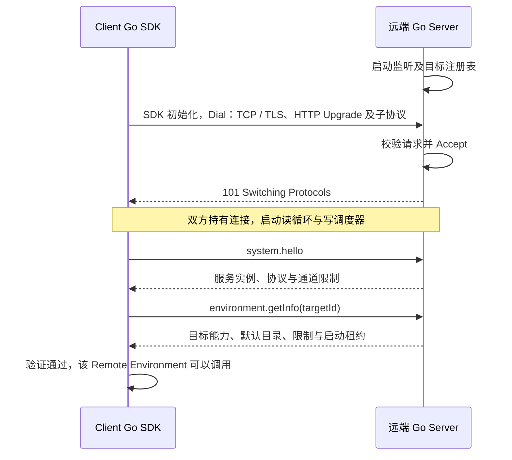

# 远端 WebSocket 通道方案

状态：共享 WS 首版已实现，使用 coder/websocket 1.8.15 与 Protobuf Go 1.36.11。Go Client 初始化时连接 Go Server，复用文件、命令输出与控制；实现入口见 [Client](../go/remote/client.go)、[Server](../go/remote/server.go)、[channel](../go/remote/channel.go)。平台与测试范围见 [执行指南](../docs/development/execution.md)。

读取触发：实现初始化建联、消息信封、并发关联、请求取消、心跳、发送队列、断线或关闭。文件业务见 [Filesystem RPC](filesystem-rpc.md)，命令业务见 [Process RPC](process-rpc.md)，资源归属见 [远端执行器](../docs/architecture/remote-executor.md)。当前 [TS ↔ 本机 Go stdio](README.md) 是另一条链路。

## 分层与连接范围

```text
Remote Filesystem / Remote Process
              ↓
RPC 调用、事件关联、取消与状态确认
              ↓
统一消息信封与 Protobuf 编码
              ↓
一条共享 WebSocket 连接
              ↓
远端分发器 → 目标 Local Filesystem / Local Process
```

“一条”指同一远端 Client 所有者持有的连接。多个已注册环境通过 targetId 复用这个 Client；不同地址或不同 Client 所有者各自建连，不按用户身份建立连接池。每次文件操作、Exec、Cancel 与 GetState 不另建独立传输连接，不增加第二条控制通道。

RPC 是 WebSocket 上的应用协议。WebSocket 提供双向消息和 Ping / Pong / Close，不能代替请求关联、业务错误、deadline、命令终态或目标进程清理。连接开放也不等于 Bash 支持交互式 stdin 或 PTY。[WebSocket 标准](https://www.rfc-editor.org/rfc/rfc6455)

## Go SDK 与 Go Server 建联

Client 侧 Go SDK 在调用方进程内持有共享 RPC 客户端，它可以运行在本机 Runner 或直接使用 SDK 的 Go 应用中。远端 Go Server 是独立部署的执行器，持有目标注册表和 Local Filesystem / Local Process。Pi / TypeScript 通过本机 stdio 调用 Runner；这里的 WS 由 Go SDK 建立。

第一版建联方向为 Go SDK 初始化期间主动 Dial、Go Server 监听并 Accept。SDK 从宿主配置取得 endpoint 和初始 targetId 集合，完成拨号、Hello 和初始目标 GetInfo 才返回可用 Client；失败清理已获取资源并返回初始化错误。Server 提供 WS 入口和已注册目标，配置形式、具体地址与依赖库继续待定；`/remote/ws` 仅为入口示例。

建联有两个阶段：

| 阶段 | Client Go SDK | 远端 Go Server | 完成条件 |
| --- | --- | --- | --- |
| WS 网络握手 | 按 ws / wss 地址发起连接，提交应用子协议 | 校验升级请求与子协议，接收连接，建立 Session | 双方取得 WS 连接对象，传输可用 |
| RPC 业务握手 | 发送 system.hello，再查询绑定目标的 environment.getInfo | 返回服务实例、协议及目标能力、限制和启动租约 | SDK 验证匹配后开放该环境的业务调用 |

按 HTTP/1.1 建连路径，SDK 先建立 TCP，使用 wss 时再完成 TLS，然后发送 HTTP Upgrade；Server 接受升级时返回 101 Switching Protocols 并接管连接。下图中的 Dial / Accept 以已核对的 coder/websocket API 为例，网络库已固定为 v1.8.15。[Dial 源码](https://github.com/coder/websocket/blob/v1.8.15/dial.go)、[Accept 源码](https://github.com/coder/websocket/blob/v1.8.15/accept.go)



两端的逻辑对象和责任如下；它们描述状态归属，不冻结代码模块或类型名：

| Client Go SDK | 远端 Go Server |
| --- | --- |
| 连接管理器：初始化拨号、就绪 / 失效状态和共享连接释放 | 服务所有者：监听、目标集合与 Session 管理 |
| 共享连接对象及连接上下文 | 每条接收连接对应的 Session 及其连接上下文 |
| 请求等待表：request_id 关联结果与事件消费 | Session 活动请求表：request_id 关联处理上下文与取消器 |
| 持续读循环与有界写调度器 | 持续读循环、方法分发器与有界写调度器 |
| RemoteFilesystem / RemoteProcess，转换领域调用与 RPC | 目标 LocalFilesystem / LocalProcess，执行真实文件与命令操作 |
| 环境记录自己发起的 executionId，组织取消和状态确认 | Session 记录所属 executionId；服务级执行登记表保存回收状态与近期终态 |

WS 成功建立后仍要完成 RPC 业务握手，不能立即放行任意目标操作。SDK 的连接所有者负责共享连接，Filesystem / Process 借用该连接；单次调用只生成请求与独立上下文，不重新拨号。取消一个调用通过控制消息完成，真实连接失效时 Server 按该 Session 处理活动上下文和未结束执行。

执行登记表独立于原 Session 的 socket 生命周期。断线后 Server 继续回收未确认执行并保留近期状态，SDK 立即报错，不重连查询。仍连通的原 Session 可 GetState 确认；新 Client / Session 不接管旧执行。Session 仅表示连接资源归属，不是身份或用户权限。

## 握手、实例与能力

1. 初始化期间使用 ws / wss 建连，第一版不做调用者认证、账号、Token 或目标 ACL；使用 wss 时保留 TLS 的连接语义，部署形式后续确定。目标必须存在，宿主自身操作错误仍保留。
2. 握手协商应用子协议 `agentkit.remote.v1.pb`。未协商到支持的版本与编码时拒绝业务调用；WebSocket 自身版本不表示本项目业务协议版本。
3. 首个应用请求为 `system.hello`，返回当前 serviceInstance、协议信息、通道限制与连接会话信息。执行器每次启动产生新 serviceInstance；握手等待有独立上限。
4. SDK 通过 `environment.getInfo` 查询绑定 targetId 的平台、默认目录、文件与 Bash 能力及限制。文档中的 Environment.GetInfo 是该内部 RPC 的能力查询名称，不增加公共 Environment 领域方法。
5. 目标可用且能力匹配后 SDK 初始化才返回可用环境；任一步失败不返回半就绪对象。连接失效后新调用立即报错，不自动重连或回退目标。

Exec 使用 Server 内存表中的有限启动接纳租约。GetInfo 返回随机 16 字节引用与剩余有效期，绑定实际 Session、服务实例与目标，由服务端计时校验；它不是认证令牌。SDK 随 Exec / 启动前 Cancel 发送引用，在仍连通的连接刷新将到期租约，不延长已分配给 executionId 的期限。默认 30 秒，刷新余量 5 秒；完整规则见 v1 契约，公共 ExecRequest 不增加租约字段。

普通请求的 timeoutMs 不能解决命令迟到启动问题：网络传输、排队与两端时钟不同，服务端必须独立校验租约。服务端在登记及进入启动阶段前检查期限，取消标记和拒绝重复启动的简要记录至少保留到该执行的最晚接纳期限；旧请求在标记过期后也不能重新启动。实例变化会使旧租约失效，完整规则见 Process RPC。

## 消息信封

一个完整 WebSocket Binary Message 对应一个 Protobuf Envelope。不把单个 WebSocket frame 视为业务消息，不额外依赖换行分隔；接收端处理库重组后的消息并执行整消息上限。WebSocket 允许消息分片，业务分块由文件与输出契约另行定义。[消息与分片](https://www.rfc-editor.org/rfc/rfc6455#section-5.4)

完整消息已形成四份 `.proto` 首版草案，正式发布前核对兼容性与生成方式：

信封、错误、取消和通道限制的字段唯一来源为 [channel.proto](remote/v1/channel.proto)。Hello / GetInfo 见 [system.proto](remote/v1/system.proto)；完整方法注册表、校验规则和初始预算见 [v1 首版契约](remote/v1/README.md)。

| 信息 | 规则 |
| --- | --- |
| request_id | SDK 生成 UUID，每次调用独立；在连接中关联请求、事件和唯一响应，不重复使用，不表示持久幂等键 |
| sequence | 普通请求响应使用 0；Exec 的 started / output 事件及 terminal 响应使用同一次执行的递增序号 |
| request.method | 使用固定方法注册表，例如 filesystem.read、process.exec，不允许由载荷指定任意函数 |
| request.body | 按方法注册表解码对应的 Protobuf 请求；targetId 与业务参数在对应消息中 |
| request.timeout_ms | 正数、有限的 RPC 时间预算；服务端从接收后建立上下文并计入自己的排队时间，客户端独立计时 |
| request.service_instance | hello 时允许为空；后续调用绑定协商的服务实例，旧执行控制保留原实例标识 |
| request.admission_lease | Exec 及启动前取消使用；不等于目标运行预算，其他方法无需提供 |
| response.outcome | 成功 body 与 error 必须且只能选择一个；空 Mkdir 响应仍显式选择 body 分支 |
| event.name / body | 只允许方法约定的事件，如 process.started / process.output；不能结束请求等待 |
| error.code / details | code 为本项目稳定业务错误，details 按原方法解码；文件使用 FileErrorDetail，不借用 WebSocket 关闭码表达业务失败 |

接收端校验非空关联 ID、方法、消息类型、响应分支、业务载荷和序号。无法解码信封或未知信封类型属于通道协议错误，结束连接并使活动调用报告连接失败；能够识别的未知方法返回该请求的 UNKNOWN_METHOD，不关闭其他调用。

文件方法产生一次 response。Exec 产生零到多个 event，最终 `response.body` 承载 terminal 业务消息，不再发送第二条完成响应。已进入执行协调的启动失败、取消、超时及非零退出按 Process 终态契约处理；可关联的信封参数、实例等启动前拒绝可以使用 response.error，只有明确的权威拒绝才能归为 not_started。

不同请求可以交错发送，客户端按 request_id 分发；同一次执行的事件和终态按序发送。响应不重复整份命令输出。接收超时或已取消请求的迟到消息不能错误结束其他请求；客户端保留有界的等待/清理关联，终态后丢弃对应迟到消息，不复用旧 ID。

## 方法与控制范围

| 方法 | 语义 |
| --- | --- |
| system.hello | 建连后确认业务协议、服务实例与通道限制 |
| environment.getInfo | 查询已配置目标的能力、限制和启动接纳租约 |
| filesystem.read / write / readDir / stat / mkdir | 文件消息和行为以 Filesystem RPC 为准 |
| process.exec | 请求与 started / output 事件、terminal 响应 |
| request.cancel | 取消同一连接内的一个活动 RPC 上下文；使用新的请求 ID，body 引用被取消的 request_id |
| process.cancel / process.getState | 按实际 Session、实例、targetId、executionId 控制或查询执行，只在原连接仍连通时使用 |

request.cancel 的 accepted 仅确认找到活动请求并提交取消，不表示目标操作已停止、没有执行或文件没有改变。它不建立跨连接文件结果查询；找不到请求时返回 accepted=false，不能据此推导原调用结果。

Process 用户上下文取消时，SDK 用独立且有界的清理上下文提交 process.cancel 并等待 terminal 或 getState。请求取消不得通过关闭共享 WS 实现。底层库的 Read / Write 使用连接所有者的上下文及连接级 I/O 预算，不直接继承某个业务调用的取消；尚未发送且已取消的排队请求在发送前丢弃。

实现时核对所选网络库的关闭行为。作为已核对的例子，coder/websocket v1.8.15 的 setupReadTimeout / setupWriteTimeout 在上下文结束时调用连接 close；把单个请求上下文直接用于共享 socket 读写会影响全部调用。该库已固定为运行依赖；单调用上下文与连接上下文在代码中分别管理。[已核对源码](https://github.com/coder/websocket/blob/v1.8.15/conn.go)

## 单通道调度与背压

连接所有者持有一个持续读循环和一个统一写调度器。读循环解码后将消息交给有界的请求处理或事件队列，不能同步执行文件操作、Bash 等待或用户输出回调；否则其他请求与心跳都会受阻。

写调度器汇总多个调用的消息，按请求保持顺序，并在请求间公平调度。控制请求、控制响应和终态保留独立额度；Exec 的终态不能越过本次执行已保留的输出，但可以避免等待其他执行的新输出。所有队列按字节与条目设置上限，限制每个输出片段和完整消息大小。

命令输出队列或总转发额度达到上限时，停止转发此后输出、标记 OutputTruncated，仍排空宿主管道；不丢失中间片段后恢复发送而伪装成完整前缀。客户端也要避免某个慢回调阻塞共享读循环，单调用消费失败按 Process 清理契约处理。

应用取消与状态查询是普通 WS 数据消息，不是 RFC 的 Ping / Pong 控制帧。优先队列只能优先处理尚未发送的消息，不能抢占已经写入 TCP 的字节；单连接存在队头阻塞，需要有界分片、发送预算和超限策略，不能承诺控制消息永远即时到达。

真实网络发送失败或连接级 I/O 截止时间耗尽属于整条通道故障，使所有依赖该连接的活动请求收到失败，并在执行侧触发该会话的断线清理。不同于仅取消一个业务调用。

## 心跳与断线立即失败

连接使用 WS Ping / Pong 检测可达性，默认间隔 15 秒、Pong 等待 5 秒；持续读循环负责处理控制帧。Pong 只证明连接响应，不证明某条命令仍正常运行或已结束。[Ping / Pong](https://www.rfc-editor.org/rfc/rfc6455#section-5.5.2)

检测断线后：

1. 本机令旧连接失效，结束其活动调用并释放等待资源；已经可能执行的文件修改报告结果未知。
2. 执行器取消该连接会话拥有的活动文件上下文，并清理它发起且尚未结束的命令；不能按 targetId 清理其他连接或环境的全部执行。
3. 网络故障可能延迟发现，目标运行预算继续由执行器落实。文件系统调用可能继续完成，不能承诺断线回滚。
4. SDK 不自动重连，也不等待恢复。Client 进入失效状态，新调用立即报 CONNECTION_CLOSED。
5. 已发送且没有权威终态的 Exec 报 unconfirmed / OUTCOME_UNKNOWN，文件修改按结果未知处理；保留连接失败原因和部分输出，未知缺口设置 OutputIncomplete。
6. 调用方可显式重新初始化 Client 处理新的业务，但不恢复原调用或接管旧 Session，不补发 Exec、Write 或 Mkdir，不将旧执行改为后台任务。

第一版没有连接会话恢复、输出重放或持久文件操作查询。重新连通不证明之前的副作用没有发生，也不证明旧进程已停止。

## 关闭与兼容

关闭单个 Remote Environment 时拒绝该环境的新调用，处理它持有的请求与 executionId 后释放连接引用；其他环境仍使用共享 WS。最后一个拥有者释放连接时才完成物理连接关闭，借用连接由外部所有者关闭。

执行器关闭先进入 draining，拒绝新 Exec 和文件请求，现有 WS 在有界清理窗口内仍处理 Cancel / GetState；保存已确认终态后尝试发送，最后进行 WS Close 并释放目标和监听资源。Close 握手不代替目标进程回收。

完整实现采用一条 WS + 消息信封 + 业务分发与有界状态管理。现有兼容入口继续使用 TS ↔ 本机 Go stdio，Runner 后接 Remote Environment，转换消息与输出。将来可另协商 WS 上的 JSON 编码用于诊断，但不能在同一子协议中混用二进制和文本载荷；本轮不交付另一条 HTTP/gRPC 远端传输。

## 实施与验证

当前已提供消息源、固定生成器、WS 构造与生命周期实现；初始化、消息校验、队列和关闭已进入代码；Server 部署配置继续待定，本版不加入身份权限或自动重连。Go SDK 与目标执行内核保持普通接口和构造函数，由 Wire 装配传输所有者与业务分发。

至少验证：同一 WS 中文件与多个 Exec 并发、乱序请求关联、空成功 body、事件与唯一终态、单请求取消不关闭连接、共享环境关闭隔离、优先控制额度与 TCP 阻塞、慢回调与有界输出、心跳失败、断线后的范围清理、断线不重连不补发、失效 Client 拒绝新调用、实例变化、租约过期及取消先到竞态。

文档中的信封和业务消息可以分别进行 Protobuf 语法验证；这不等于已交付 WS、RPC 或跨平台运行行为。
